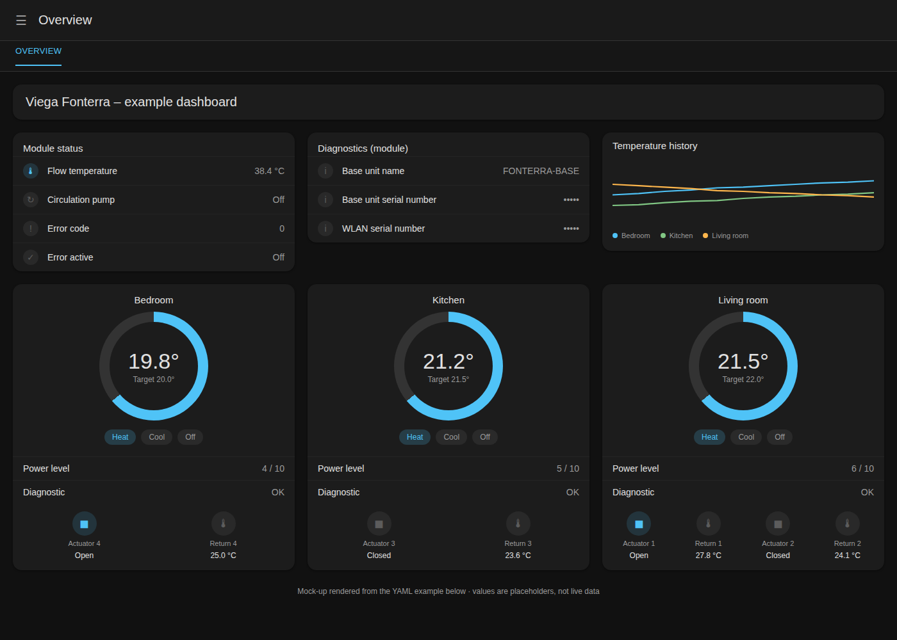

# Viega Fonterra Smart Control for Home Assistant

[](https://github.com/mikefogel/homeassistant-viega-fonterra-modbus/actions/workflows/tests.yml)
[](https://github.com/mikefogel/homeassistant-viega-fonterra-modbus/actions/workflows/validate.yml)
[](https://github.com/mikefogel/homeassistant-viega-fonterra-modbus/actions/workflows/latest-home-assistant.yml)

> **⚠️ Disclaimer — please read**
>
> This is an **independent, community-developed, unofficial** Home Assistant integration.
>
> - It is **not** created, endorsed, certified, sponsored, or supported by **Viega GmbH** or any of its affiliates, and the author has no business relationship with Viega GmbH.
> - "Viega", "Fonterra", and "Fonterra Smart Control" are trademarks of Viega GmbH, used in this repository only to identify the hardware this integration talks to (nominative use) — not to suggest any endorsement or partnership.
> - This integration was built from Viega's own **publicly published** Fonterra Smart Control user manual (see "Documentation" below) together with independent verification against real hardware (Modbus wire captures). No confidential Viega SDK, API, or internal documentation was used, and none is required to use or review this project.
> - **Use at your own risk.** This integration reads from and writes to your heating installation's Modbus interface. The author accepts no liability for damage to your heating system, property, or data arising from its use.
> - Using third-party software with your installation may affect Viega's own warranty or support terms — if in doubt, ask your installer or Viega directly.
> - Provided **"as is", without warranty of any kind, express or implied** — see the MIT license at the bottom of this file for the exact legal terms.


This custom integration connects one or more Viega Fonterra Smart Control systems to Home Assistant over local Modbus TCP. It provides room thermostats, register sensors, actuator controls, and diagnostic information.

## Features

- Multiple independently configured Viega modules
- Home Assistant UI setup and reconfiguration — no YAML editing
- Automatic room and actuator discovery straight from the device; no manual room mapping needed
- IP address or hostname and configurable Modbus TCP port
- Editable module and room names
- Room climate entities with current and target temperature
- Target-temperature writes through documented holding registers, with read-after-write verification against the device's own next reading
- Operating mode and profile mode controls, plus on/off (standby with frost protection)
- What each room is doing right now — heating, cooling, idle, or off — shown on the built-in thermostat and tile cards and as colored bands in the history graph
- Room power-level Number entities
- Flow temperature (one shared entity per module), per-actuator return temperature, and per-actuator position (open/closed)
- Derived, debounced circulation-pump indicator for driving your own pump automation, with a ready-made, one-click importable blueprint (including a run-on time), plus derived actuator statistics (open count, transition count, cumulative open time)
- Guide for daily heating time per room with Home Assistant's built-in helpers, as a bar chart per day
- WLAN module and base-unit identity diagnostics
- Base-unit error code and error status
- Automatic reconnection after a lost connection, with connection-health diagnostics and an on-demand rediscovery action for an already-running module
- Notifications under Settings → Repairs when a module is unreachable for 30 minutes or the base unit reports an error code, with the code's meaning translated
- Clear, translated error messages when a change can't be applied, in the setup dialogs and for every action
- One polling cycle per module that updates all of its entities together, with adjacent registers read in a single request
- A multi-module overview for installations with more than one Viega module
- Localized (German/English) entity names, states (e.g. "Kein Fehler"), units (power level "Stufe") and thermostat preset labels, plus fitting icons (valve for actuators, pump for the pump indicator)
- Downloadable configuration diagnostics (JSON) for checking an installation against the device
- Optional Modbus TX/RX frame-level debug logging
- Transaction-ID, function-code, and response-length validation on every Modbus frame
- Preservation of the last valid value for invalid readings (`-99`) and communication failures, even across repeated consecutive errors

## Requirements

- Home Assistant 2024.6.0 or newer (per `hacs.json`)
- A Viega Fonterra Smart Control system with Modbus TCP enabled
- Network access from Home Assistant to the WLAN module or base unit

The Fonterra manual states that Modbus TCP must be enabled in the device software (via the Fonterra Smart Control web interface or app). The default endpoint used by this integration is:

- Host: `192.168.0.188`
- Port: `502` (the manual's normal/DHCP network port; `192.168.1.1` is only used in point-to-point mode)

Both values are only defaults for the setup form — use your device's actual IP address or hostname and port, and change them any time afterward through reconfiguration.

### Verified setup

The author runs this integration in daily use on a kept-up-to-date Home Assistant instance hosted on a Raspberry Pi 4, controlling three separate Fonterra Smart Control base units (Dachgeschoss/Obergeschoss/Erdgeschoss), all currently on base-unit firmware **4.3-6.10**. This is the configuration the integration is actually developed and exercised against day to day — it isn't a compatibility guarantee for other hardware, Home Assistant versions, or firmware versions (see the disclaimer at the top of this file).

## Installation

### HACS

1. Open HACS in Home Assistant.
2. Search for **Viega Fonterra Smart Control**.
3. Install the integration.
4. Restart Home Assistant.

### Manual

Copy the `custom_components/viega_fonterra_modbus` directory into the `custom_components` directory of your Home Assistant configuration, then restart Home Assistant.

## Setup

Open **Settings > Devices & services > Add integration** and select **Viega Fonterra Smart Control**.

The setup form accepts:

| Field | Description | Default |
| --- | --- | --- |
| Host | IPv4 address or resolvable hostname of the WLAN module/base unit | `192.168.0.188` |
| Port | Modbus TCP port | `502` |
| Device name | The Home Assistant device name for this module | `Fonterra` |
| Polling interval | Seconds between two polling cycles of the module (all its values are read once per cycle) | `30` (range `5`–`300`) |
| Modbus timeout | Seconds to wait for a Modbus response | `5` (range `1`–`30`) |

The integration validates the connection before creating the entry. To add another Fonterra module (a second physical base unit), repeat the setup flow with that module's own host/port/device name — each module gets its own connection, device, polling configuration, and entities, and one module's failure or reload never affects another.

Example: two modules on the same Home Assistant installation:

| | Module 1 | Module 2 |
| --- | --- | --- |
| Host | `192.168.0.188` | `192.168.0.189` |
| Port | `502` | `502` |
| Device name | `Fonterra Erdgeschoss` | `Fonterra Obergeschoss` |
| Polling interval | `30` | `30` |
| Modbus timeout | `5` | `5` |

There is no room-mapping field on this form. Rooms and their actuator(s) are
discovered automatically from the device itself once it connects: the
integration reads every actuator's "Raum ID" register to see which room it
serves, and each room's own name register for its display name. This runs
again on every setup/reload, so it reflects the physical installation even
if it changes later (an actuator moved to a different room, a room renamed
on the base unit). If the device can't be reached during a particular setup
cycle, the last successfully discovered mapping is kept instead.

If discovery has never succeeded even once (for example, the device was
unreachable during the very first setup), no room, climate, or Number
entities are created and a warning is logged — there is currently no way to
type in a room mapping from scratch through the UI as a substitute. Make
sure the device is reachable and Modbus TCP is enabled before adding the
module, and reload the integration entry once it is.

Room names are used for climate, Number, sensor, and diagnostic entity names.

## Reconfiguration

Open the integration entry and select **Configure** to change the module's device name, host, port, polling interval, and Modbus timeout. For every room the device has already reported, you can also override its display name, actuator number, sensor number, and target-temperature register. The connection is tested before changes are accepted, and the integration reloads the module automatically after a successful change (which re-runs discovery and may overwrite a manual override if the device now reports something different for that room).

Entity unique IDs are based on the config entry and room ID, so renaming a module or room does not create duplicate entities.

## Entities

Depending on the discovered rooms/actuators and available registers, the integration creates (device/room names below are examples — yours will use your own configured names):

| Platform | Example entity ID | What it shows |
| --- | --- | --- |
| Climate | `climate.fonterra_wohnzimmer` | Current/target temperature, heating/cooling mode, on/off, profile mode, current activity (heating/cooling/idle/off) |
| Number | `number.fonterra_wohnzimmer_power_level` | Room actuator power level (`0`–`10`) |
| Sensor | `sensor.fonterra_flow_temperature` | Base-unit flow temperature (one entity per module) |
| Sensor | `sensor.fonterra_wohnzimmer_actuator_1_return_temperature` | One actuator's return temperature |
| Binary sensor | `binary_sensor.fonterra_wohnzimmer_actuator_1_position` | One actuator's position (open/closed) |
| Sensor | `sensor.fonterra_wlan_serial_number` / `..._base_unit_serial_number` / `..._base_unit_name` | Diagnostic identity values |
| Sensor | `sensor.fonterra_base_unit_error_code` | Raw base-unit error code + translated description |
| Binary sensor | `binary_sensor.fonterra_base_unit_error` | On when the base-unit error code is non-zero |
| Sensor | `sensor.fonterra_wohnzimmer_diagnostic` | That room's error/warning state in your language (e.g. "Kein Fehler", "Warnung: Batterie des Raumthermostats schwach"), with the raw code as attribute |
| Binary sensor | `binary_sensor.fonterra_circulation_pump` | Derived circulation-pump indicator (see below) |
| Sensor | `sensor.fonterra_last_successful_modbus_response` and seven more `..._health_*` sensors | Connection health metrics (see below) |
| Sensor | `sensor.fonterra_currently_open_actuators` and three more `..._actuator_stats_*` sensors | Derived actuator statistics (see below) |

Operating mode and profile mode are set on the base unit itself, not per
room — changing them from any one room's thermostat card changes them for
every room at once. This matches the physical device (there is only one
Betriebsmodus/Profilmodus register for the whole installation) and is not a
bug. The same applies to the thermostat card's on/off control: turning one
room off puts the whole module into standby (frost protection stays active),
and turning it on restores the last active mode (heating or cooling).

The profile mode (Manual/Profile/Setback) only exists in heating mode on the
device, so the preset control is shown only while the module is heating.

Each room's climate entity also reports what the room is doing right now:
**Heating**/**Cooling** while at least one of the room's actuators is open,
**Idle** while all of them are closed, and **Off** in standby. Home
Assistant's built-in thermostat and tile cards show this as text and color,
and the climate entity's history graph shows colored bands for the periods in
which the room was actually heating or cooling.

The Fonterra register map uses signed 16-bit input values. Temperatures are scaled according to the manual: room and target temperatures use tenths of a degree Celsius, as do flow and return temperatures. The integration converts these values before exposing them to Home Assistant.

### Circulation pump indicator

`binary_sensor.<device>_circulation_pump` (one per module, device class "running") is a **derived** indicator, not a device register — the Fonterra base unit has no circulation-pump register at all. It is:

- **on** when at least one of the module's used actuators (one actually assigned to a room by discovery) is confirmed open
- **off** once every used actuator is confirmed closed
- **unknown/unavailable** until the first actuator has settled

Every actuator's raw open/closed reading is debounced before it can affect this entity: a reading only counts once the actuator's position register has returned the *same* value on 3 consecutive reads, so a single noisy or transitional reading cannot flip the pump. A failed read or a `-99` value is skipped — it neither advances nor resets that actuator's debounce counter.

This entity writes nothing back to the device and does not control anything on the Fonterra system. It is meant to drive your own automation for a circulation pump that is wired and switched independently (e.g. via a smart relay).

The easiest way is the ready-made blueprint — import it, pick the indicator and your pump switch, and set a run-on time (default 5 minutes):

[](https://my.home-assistant.io/redirect/blueprint_import/?blueprint_url=https%3A%2F%2Fgithub.com%2Fmikefogel%2Fhomeassistant-viega-fonterra-modbus%2Fblob%2Fmain%2Fblueprints%2Fautomation%2Fviega_fonterra_modbus%2Fcirculation_pump.yaml)

The pump turns on as soon as any actuator opens and off once all actuators have stayed closed for the run-on time; if an actuator opens again in between, the pump simply keeps running. After a Home Assistant restart with open actuators it is switched on right away, and an unavailable indicator leaves the pump as it is. ([Blueprint source](blueprints/automation/viega_fonterra_modbus/circulation_pump.yaml))

If you prefer a plain automation without run-on time:

```yaml
automation:
  - alias: "Heizkreispumpe folgt Fonterra-Aktoren"
    trigger:
      - platform: state
        entity_id: binary_sensor.fonterra_circulation_pump
    condition:
      - condition: template
        value_template: "{{ trigger.to_state.state in ['on', 'off'] }}"
    action:
      - service: switch.turn_{{ 'on' if trigger.to_state.state == 'on' else 'off' }}
        target:
          entity_id: switch.heizkreispumpe
```

### Connection health metrics

Each module also exposes eight diagnostic sensors derived entirely from the shared Modbus client's own bookkeeping — none of them issues an extra Modbus request:

- last successful response timestamp
- last failed request timestamp
- consecutive communication-failure count
- invalid-value count (including the `-99` sentinel)
- last Modbus exception code, when available
- duration of the most recent successful request
- number of automatic reconnections, and the time of the last one

These are diagnostic only: a communication failure never overwrites a room's last valid value, and no host/port/network information is exposed through them.

### Repairs notifications

Problems that need your attention show up under **Settings → Repairs**, so you notice them even without looking at the dashboard:

- **Module not reachable** — no response from a module for 30 minutes.
- **Base-unit error** — the base unit reports an error code, with the code's meaning from the Viega manual (e.g. "Replace the backup battery"). Warnings such as a weak thermostat battery are shown as warnings, faults as errors.

Both disappear on their own once the problem is gone. They use only values the integration already reads.

### Automatic reconnection

If the connection to a module drops — the base unit or WLAN module restarts, the Wi-Fi or router goes down, or the device closes the connection — the integration reconnects on its own as soon as the module is reachable again; no reload is needed. While the module is unreachable, every entity keeps its last valid value. Reconnection attempts back off from 5 seconds up to the module's polling interval, a read that hit a broken connection is retried once on the new connection, and writes are never repeated automatically. The log shows one warning when the connection is lost and one info message when it is restored.

### Rediscovering the topology on demand

Beyond the automatic discovery that runs on every setup (see "Setup" above), you can trigger a rediscovery of an already-running module at any time with the `viega_fonterra_modbus.rediscover` service (Developer Tools → Actions), targeting the module's device. It re-reads the actuator Raum-ID and room-name registers, compares the result with the currently loaded topology, and updates entities in place — added, removed, renamed, or reassigned rooms and actuators are logged and reported as a `viega_fonterra_modbus_rediscovery` event — without reloading the config entry or reconnecting. If the device can't be read during the rediscovery attempt, the previously working topology is left untouched.

### Write verification

After writing a target temperature, operating mode, profile mode, or power level, the integration starts a polling cycle right away and checks the device's own next valid read of that register against what was written. If the device reports something else (a rejected or overridden write), the displayed value is reconciled to what the device actually reports and a warning is logged — the device's value is always authoritative.

### One polling cycle per module

Each module is read in one polling cycle per polling interval: the integration reads every value the module's entities need and then updates all of them together — entities are not polled by Home Assistant one by one. After you change a value (temperature, mode, preset, power level) the next cycle runs right away, so the device's own value shows up within seconds instead of after a full interval.

Within a cycle, registers that are adjacent on the device (e.g. two rooms' power-level/target-temperature registers, or one actuator's position/return-temperature registers) are read with a single Modbus request. Input and holding registers are never combined, and an undocumented gap between two registers is never bridged. If one of these requests fails, only its values are skipped for that cycle: the affected entities keep their last valid values and stay available, and the next cycle tries again.

### Extended diagnostics snapshot

The "Download diagnostics" export (see "Verifying your configuration" below) also includes a small, bounded `extended` section: the connection-health counters above plus a short history of recent Modbus exception codes, the exact documented register addresses a normal polling cycle reads for your topology, and the most recent rediscovery's added/removed/renamed/reassigned diff, if any. It contains no host/IP/credential data and no firmware/version guesses — the device doesn't document a version register, so none is fabricated.

### Derived actuator statistics

Four more diagnostic sensors are derived from the circulation-pump indicator's own debounced actuator readings, without any extra Modbus traffic:

- number of actuators currently confirmed open
- confirmed open-transition count (how many times the pump indicator has turned on)
- timestamp of the last confirmed transition (on↔off)
- cumulative confirmed-open time

These are computed values, not device registers, and are not a substitute for the circulation-pump binary sensor itself. The open-actuator count stays unavailable until at least one actuator has completed its debounce cycle and is never restored to a stale value after a restart; the transition count, cumulative open time, and last-transition timestamp do restore.

### Multi-module overview

If you have more than one Viega Fonterra module configured, the `viega_fonterra_modbus.overview` service (Developer Tools → Actions, "response data" enabled) returns a per-module summary in one call: reachability, whether a base-unit error is active, whether communication looks stale or failed, and the room/actuator count — all without any extra Modbus read. Two modules' same-named rooms (e.g. both called "Wohnzimmer") are never merged: every room and every module in the response always carries its own config entry ID. One module's failure while building the summary never affects another module's entry in the response.

## Example dashboard

A minimal Lovelace overview built entirely from Home Assistant's built-in
cards (`thermostat`, `entities`, `glance`, `history-graph`, `markdown`) — no
HACS frontend cards required. It fits one module with a handful of rooms on
a single view: module-wide status and diagnostics at the top, one block per
room below, and a combined temperature history at the end.



This is a mock-up built to illustrate the layout, not a live screenshot —
render the YAML below against your own entities to see your actual values.

Every entity ID below follows the pattern already used in
["Entities"](#entities) above: `<domain>.<device_name>_<room_name>[...]`. The
example uses the default device name `fonterra` and three generic room
names (`bedroom`, `kitchen`, `living_room`, the last one with two actuators
to show the multi-actuator case) — replace both with your own device and
room names. You can look up your exact entity IDs under **Developer tools →
States**, filtered by your device name.

```yaml
title: Heating
views:
  - title: Overview
    path: heating-overview
    icon: mdi:radiator
    cards:
      # Header
      - type: markdown
        content: "## Viega Fonterra – <device_name>"

      # Module-wide status (one of these per module)
      - type: entities
        title: Module status
        entities:
          - entity: sensor.<device_name>_flow_temperature
            name: Flow temperature
          - entity: binary_sensor.<device_name>_circulation_pump
            name: Circulation pump
          - entity: sensor.<device_name>_base_unit_error_code
            name: Error code
          - entity: binary_sensor.<device_name>_base_unit_error
            name: Error active

      - type: entities
        title: Diagnostics (module)
        entities:
          - entity: sensor.<device_name>_base_unit_name
          - entity: sensor.<device_name>_base_unit_serial_number
          - entity: sensor.<device_name>_wlan_serial_number

      # One block per room — copy this vertical-stack for each room
      - type: vertical-stack
        cards:
          - type: thermostat
            entity: climate.<device_name>_<room_name>

          - type: entities
            title: <Room name> details
            entities:
              - entity: number.<device_name>_<room_name>_power_level
                name: Power level
              - entity: sensor.<device_name>_<room_name>_diagnostic
                name: Diagnostic

          - type: glance
            title: <Room name> actuator(s)
            entities:
              - entity: binary_sensor.<device_name>_<room_name>_actuator_<N>_position
                name: Actuator <N>
              - entity: sensor.<device_name>_<room_name>_actuator_<N>_return_temperature
                name: Return <N>
              # a room with more than one actuator (spec.md 4) repeats this
              # pair of lines once per actuator number

      # Repeat the vertical-stack block above for every other room ...

      # Compare every room's temperature over time
      - type: history-graph
        title: Temperature history
        hours_to_show: 24
        entities:
          - entity: climate.<device_name>_<room_name>
          # add the remaining rooms here
```

Filled in for three rooms — a single-actuator `bedroom` and `kitchen`, and a
`living_room` with two actuators (actuator numbers are illustrative; use the
ones your own installation actually discovered):

```yaml
title: Heating
views:
  - title: Overview
    path: heating-overview
    icon: mdi:radiator
    cards:
      - type: markdown
        content: "## Viega Fonterra – Fonterra"

      - type: entities
        title: Module status
        entities:
          - entity: sensor.fonterra_flow_temperature
            name: Flow temperature
          - entity: binary_sensor.fonterra_circulation_pump
            name: Circulation pump
          - entity: sensor.fonterra_base_unit_error_code
            name: Error code
          - entity: binary_sensor.fonterra_base_unit_error
            name: Error active

      - type: entities
        title: Diagnostics (module)
        entities:
          - entity: sensor.fonterra_base_unit_name
          - entity: sensor.fonterra_base_unit_serial_number
          - entity: sensor.fonterra_wlan_serial_number

      # --- Bedroom (1 actuator) ------------------------------------------
      - type: vertical-stack
        cards:
          - type: thermostat
            entity: climate.fonterra_bedroom
          - type: entities
            title: Bedroom details
            entities:
              - entity: number.fonterra_bedroom_power_level
                name: Power level
              - entity: sensor.fonterra_bedroom_diagnostic
                name: Diagnostic
          - type: glance
            title: Bedroom actuator
            entities:
              - entity: binary_sensor.fonterra_bedroom_actuator_4_position
                name: Actuator 4
              - entity: sensor.fonterra_bedroom_actuator_4_return_temperature
                name: Return 4

      # --- Kitchen (1 actuator) -------------------------------------------
      - type: vertical-stack
        cards:
          - type: thermostat
            entity: climate.fonterra_kitchen
          - type: entities
            title: Kitchen details
            entities:
              - entity: number.fonterra_kitchen_power_level
                name: Power level
              - entity: sensor.fonterra_kitchen_diagnostic
                name: Diagnostic
          - type: glance
            title: Kitchen actuator
            entities:
              - entity: binary_sensor.fonterra_kitchen_actuator_3_position
                name: Actuator 3
              - entity: sensor.fonterra_kitchen_actuator_3_return_temperature
                name: Return 3

      # --- Living room (2 actuators) ---------------------------------------
      - type: vertical-stack
        cards:
          - type: thermostat
            entity: climate.fonterra_living_room
          - type: entities
            title: Living room details
            entities:
              - entity: number.fonterra_living_room_power_level
                name: Power level
              - entity: sensor.fonterra_living_room_diagnostic
                name: Diagnostic
          - type: glance
            title: Living room actuators
            entities:
              - entity: binary_sensor.fonterra_living_room_actuator_1_position
                name: Actuator 1
              - entity: sensor.fonterra_living_room_actuator_1_return_temperature
                name: Return 1
              - entity: binary_sensor.fonterra_living_room_actuator_2_position
                name: Actuator 2
              - entity: sensor.fonterra_living_room_actuator_2_return_temperature
                name: Return 2

      - type: history-graph
        title: Temperature history
        hours_to_show: 24
        entities:
          - entity: climate.fonterra_bedroom
          - entity: climate.fonterra_kitchen
          - entity: climate.fonterra_living_room
```

Remember that `hvac_mode` and `preset_mode` are shared across every room of
the same module (see "Entities" above): the thermostat card's mode buttons
change them for the whole module, whichever room's card you use.

For a more compact view with many rooms, the built-in **tile** card works
just as well — it shows the room's current activity (heating/idle/...) and
puts the controls directly on the tile:

```yaml
type: tile
entity: climate.fonterra_living_room
features:
  - type: target-temperature
  - type: climate-preset-modes
    style: icons
    preset_modes: [manual, profile, setback]
```

## Heating time per room

Each room's climate entity reports what the room is doing right now (see "Entities"), so Home Assistant can add up how long a room has been heating each day — handy for seeing which rooms need the most heat. It takes two built-in helpers per room and no extra integration. Recording starts with version 1.1.0 of this integration; earlier history has no heating information.

**1. A "room is heating" sensor.** *Settings → Devices & services → Helpers → Create helper → Template → Template a binary sensor*:

- Name: `Küche heizt`
- State template: `{{ state_attr('climate.fonterra_kuche', 'hvac_action') == 'heating' }}`

Use your room's climate entity ID. For cooling, compare with `'cooling'` instead.

**2. The daily heating time.** *Create helper → History stats* (on older Home Assistant versions without this helper in the UI, use the YAML below):

- Entity: `binary_sensor.kuche_heizt` (Home Assistant drops umlauts from entity IDs: "Küche" becomes `kuche`)
- State: `on`
- Type: *Time*
- Start: `{{ today_at() }}`, End: `{{ now() }}`

The result, e.g. `sensor.kuche_heizdauer_heute`, shows today's heating time in hours and starts again at 0 every midnight.

The same in YAML (`configuration.yaml`):

```yaml
template:
  - binary_sensor:
      - name: "Küche heizt"
        state: "{{ state_attr('climate.fonterra_kuche', 'hvac_action') == 'heating' }}"

sensor:
  - platform: history_stats
    name: "Küche Heizdauer heute"
    entity_id: binary_sensor.kuche_heizt
    state: "on"
    type: time
    start: "{{ today_at() }}"
    end: "{{ now() }}"
```

To compare rooms day by day, the built-in **statistics graph** card shows the daily totals as bars (the daily maximum of a value that resets at midnight is that day's total):

```yaml
type: statistics-graph
title: Heating time per day
chart_type: bar
period: day
days_to_show: 14
stat_types:
  - max
entities:
  - sensor.kuche_heizdauer_heute
  - sensor.wohnzimmer_heizdauer_heute
```

## Verifying your configuration

Two built-in ways to check that the integration resolved your installation correctly, without editing any files:

- **Settings → Devices & services → Viega Fonterra Smart Control → (module) → Download diagnostics** exports a JSON file with the module's identity (serial numbers, base-unit name) and every discovered room's name, id, and actuator(s) with the exact register addresses each one resolves to. The host address is redacted.
- [`RegisterMap.md`](RegisterMap.md) in this repository lists every documented register address from the manual and which entity reads/writes it, so you can cross-check the diagnostics export against the manual by hand.

## Modbus debug logging

Frame logging is disabled by default and has exactly one switch: the Home Assistant logger level for this integration's Modbus transport. In `configuration.yaml`, set:

```yaml
logger:
  default: info
  logs:
    custom_components.viega_fonterra_modbus.modbus: debug
    custom_components.viega_fonterra_modbus: debug
```

With that enabled, every transmitted (`TX`) and received (`RX`) frame appears in the Home Assistant log (or **Settings → System → Logs**) with direction, host, port, frame length, transaction ID, unit ID, function code, and the complete frame in hexadecimal. The second logger line (`custom_components.viega_fonterra_modbus`, without `.modbus`) additionally logs the resolved room/actuator topology on every setup — which room a given actuator was assigned to and which registers back each of its entities — useful for cross-checking against the physical installation. Do not leave either enabled permanently on a busy installation — they log a line for every single register read/write.

## Troubleshooting

### Connection failed

Check that Modbus TCP is enabled in the Fonterra software and that Home Assistant can reach the configured host and port. The default endpoint used by the setup form is `192.168.0.188:502`; use your device's actual address if it differs.

### No rooms, climate, or Number entities were created

This means automatic discovery has never succeeded for this module (see "Setup" above) — check the Home Assistant log for the warning from `custom_components.viega_fonterra_modbus`, confirm the device is reachable and Modbus TCP is enabled, then reload the integration entry (three-dot menu on the entry → Reload).

### Values are unavailable or show as `-99`

A register value of `-99` means the device itself considers the value unavailable (for example, no room thermostat is paired for that room). The integration keeps the previous valid value and exposes the communication problem through the room's diagnostic entity. Cross-check the affected room/actuator's register addresses using "Verifying your configuration" above.

### A Repairs entry says the module is not reachable

The module has not answered for 30 minutes. The integration keeps reconnecting on its own (see "Automatic reconnection"); all values stay at their last known state in the meantime. Check that the base unit and its WLAN module have power and network, and that nothing else (e.g. a router change) moved the module to a different IP address — if it did, update the host under **Configure**. The entry disappears by itself once the module answers again.

### The heating bands in the history graph look striped

Expected: Fonterra actuators often open and close every few minutes while regulating, and a room's activity (heating/idle) follows them directly. The striping shows when water actually flows. Whether to smooth this is an open item (see `spec.md` §17).

### Changing the mode/preset in one room changes it everywhere

Expected — see "Entities" above: operating mode and profile mode are one shared register per base unit, not per room.

### A module won't delete, or the integration entry's "Delete" seems to hang

Removing a module always succeeds, even when its device is offline or unreachable — the socket close is time-bounded to the module's configured Modbus timeout. The device can also be removed from its own device page (Settings → Devices & services → Devices → the module), not only from the integration entry.

### The preset control is missing

Expected in cooling mode and in standby: the device only offers profile mode (Manual/Profile/Setback) while heating, so the preset control is only shown in heating mode.

### Preset labels ("Manuell"/"Profil"/"Absenkbetrieb") show in English

Home Assistant loads entity translations once per language/session; reload the browser tab (or restart Home Assistant after upgrading the integration) if labels look stale after an update.

### Home Assistant reports an integration or platform error

Restart Home Assistant after installing or upgrading the integration. Confirm that `manifest.json` contains `config_flow: true` and that the integration is located at `custom_components/viega_fonterra_modbus/`.

## Reporting an issue

Please open an issue at the [issue tracker](https://github.com/mikefogel/homeassistant-viega-fonterra-modbus/issues) with:

1. **The integration version** — `manifest.json`'s `version`, also shown on the integration's page under Settings → Devices & services.
2. **Your Home Assistant version** — Settings → System → General.
3. **A short description of what you expected vs. what actually happened**, including which room/entity is affected.
4. **The diagnostics export** for the affected module — see "Verifying your configuration" above ("Download diagnostics"). It contains the resolved room/actuator topology and register addresses, with the host redacted; please still remove anything else you consider sensitive (e.g. serial numbers) before attaching it if you'd rather not share them.
5. **A debug log excerpt** covering the problem, if it's about a specific read/write or about discovery — see "Modbus debug logging" above for how to enable it. A few seconds around the relevant TX/RX frames is usually enough; you don't need to attach a full log.
6. **The relevant page(s) of the Viega manual**, if you believe a register address or behavior differs from what `spec.md`/`RegisterMap.md` document, so it can be checked against the source.

Bug reports that come with a diagnostics export and/or a debug log excerpt are much faster to act on than a description alone, since register addresses and topology issues are otherwise hard to reproduce without your exact hardware.

## Development

This is a community project maintained on a best-effort basis. Issues and pull requests are welcome; response time is not guaranteed.

### Running tests

The pinned test environment needs Python 3.12:

```bash
python3.12 -m venv .venv
.venv/bin/pip install -r requirements-test.txt
.venv/bin/python -m pytest
```

To check against the newest Home Assistant as well (needs the Python version that release requires, currently 3.14):

```bash
python3.14 -m venv .venv-latest
.venv-latest/bin/pip install pytest-homeassistant-custom-component
.venv-latest/bin/python -m pytest
```

Home Assistant's own validator (hassfest) runs locally with Docker or Podman:

```bash
docker run --rm -v "$PWD":/github/workspace:ro ghcr.io/home-assistant/hassfest
```

### Continuous integration

GitHub Actions run on every push to `main` and every pull request: the test suite (`tests.yml`), hassfest and the HACS validation (`validate.yml`). Every Monday the test suite also runs against the newest Home Assistant release (`latest-home-assistant.yml`) as an early warning; a failure there means the pinned test version should be updated, not that the current release is broken. The badges at the top of this file show the current status.

### Releases

Every user-visible change is listed under "Unreleased" in [CHANGELOG.md](CHANGELOG.md). A release renames that section to the new version, sets the same version in `manifest.json` (e.g. `1.2.0`) and the Git tag (`v1.2.0`), and uses the section as the GitHub release notes. Tests, CI workflows and other development files are excluded from release downloads via `.gitattributes`; HACS only installs `custom_components/viega_fonterra_modbus/`.

### Project structure

```
custom_components/viega_fonterra_modbus/
├── __init__.py          # Setup/unload, domain-wide services (rediscover, overview)
├── config_flow.py       # Setup and options flow
├── climate.py           # Room Climate entity
├── sensor.py            # Identity, health, actuator-statistics, and per-actuator sensors
├── binary_sensor.py     # Base-unit error, actuator position, circulation pump
├── number.py             # Room power-level entity
├── diagnostic.py         # Per-room diagnostic text entity
├── diagnostics.py        # Home Assistant "Download diagnostics" export
├── modbus_handler.py     # Modbus TCP client and connection-health bookkeeping
├── coordinator.py        # One polling cycle per module (block reads) feeding all entities
├── entity.py             # Base class for entities updated by the coordinator
├── errors.py             # Translated errors for user actions
├── issues.py             # Settings → Repairs entries (unreachable module, base-unit errors)
├── registers.py          # Register address map and topology helpers
├── room_mapping.py       # Automatic room/actuator discovery
├── rediscovery.py        # Explicit rediscovery action
├── overview.py           # Multi-module overview
├── entity_tracking.py    # Per-room entity bookkeeping used by rediscovery
├── device.py             # Shared device_info builder
├── const.py              # Constants and defaults
├── translations/         # German and English texts (entities, dialogs, errors, repairs)
├── services.yaml         # Service definitions (rediscover, overview)
└── manifest.json         # Integration metadata (domain, version, ...)

blueprints/automation/viega_fonterra_modbus/
└── circulation_pump.yaml # Circulation-pump blueprint
tests/                    # Test suite (pytest-homeassistant-custom-component)
.github/workflows/        # CI: tests, hassfest/HACS validation, weekly latest-HA run
spec.md                   # Binding specification
CHANGELOG.md              # User-visible changes per version
```

## Icon / branding

[`brands/custom_integrations/viega_fonterra_modbus/`](brands/custom_integrations/viega_fonterra_modbus/) contains `icon.png`/`icon@2x.png` (and dark-theme variants) — an original underfloor-heating design (warmth rising from a floor, not the Viega logo or any other vendor's), laid out exactly as the [home-assistant/brands](https://github.com/home-assistant/brands) repository expects for `custom_integrations/viega_fonterra_modbus/`. Home Assistant's own UI (Settings → Devices & services) only shows a custom integration's icon once that repository has merged it; these files are ready to submit there as a pull request but have not been submitted yet, so the icon won't appear there until that happens — it does already show up wherever this repository's own files are rendered directly (this README, HACS's repository listing).

## Documentation

- [System specification](spec.md)
- [Changelog](CHANGELOG.md)
- [Register address map](RegisterMap.md)
- [Viega Fonterra Smart Control manual](https://www.viega.de/content/dam/viega-assets/viega-worldwide-assets/products/surface-tempering/fonterra-smart-control/technical-documents/instructions-for-use/Fonterra%20Smart%20Control-de-DE.pdf) (hosted by Viega, see "Third-party documentation" below)
- [Home Assistant documentation](https://www.home-assistant.io/)

## Third-party documentation

This repository's own MIT license (below) covers only the integration's code and documentation. The Viega Fonterra Smart Control manual is © Viega and is not distributed with this repository — it is linked, hosted on Viega's own site, under "Documentation" above.

## Trademarks

"Viega", "Fonterra", and "Fonterra Smart Control" are trademarks of Viega GmbH. This project is an independent, unofficial integration, not affiliated with, endorsed by, or sponsored by Viega GmbH; the names are used solely to identify the hardware this integration is compatible with (nominative use).

## License

MIT. See [LICENSE](LICENSE). The license covers this repository's own code and documentation only — see "Third-party documentation" and "Trademarks" above for what it does not cover.
