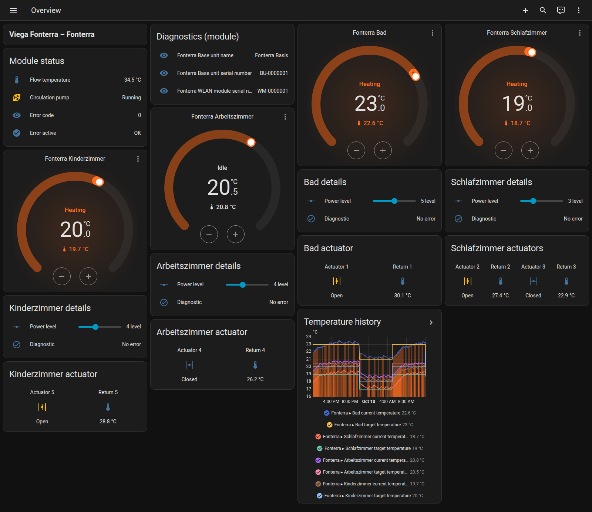
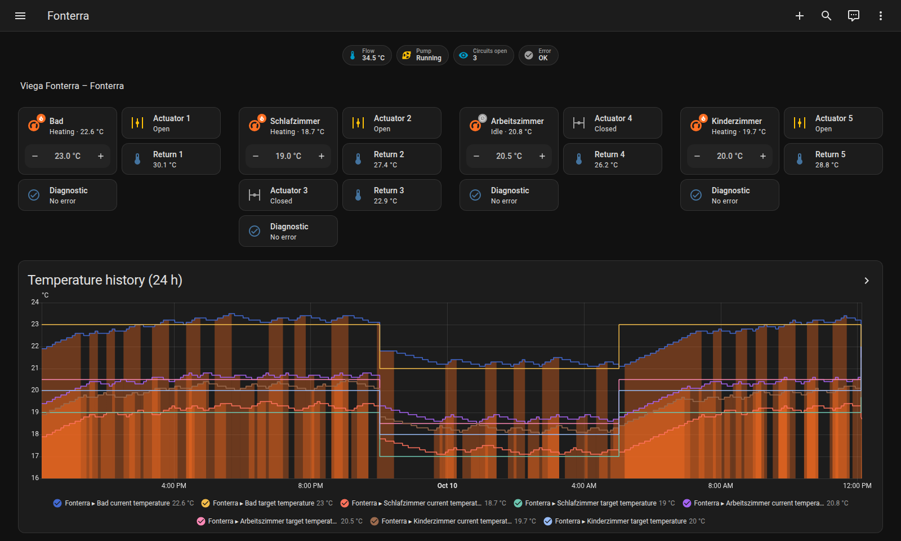
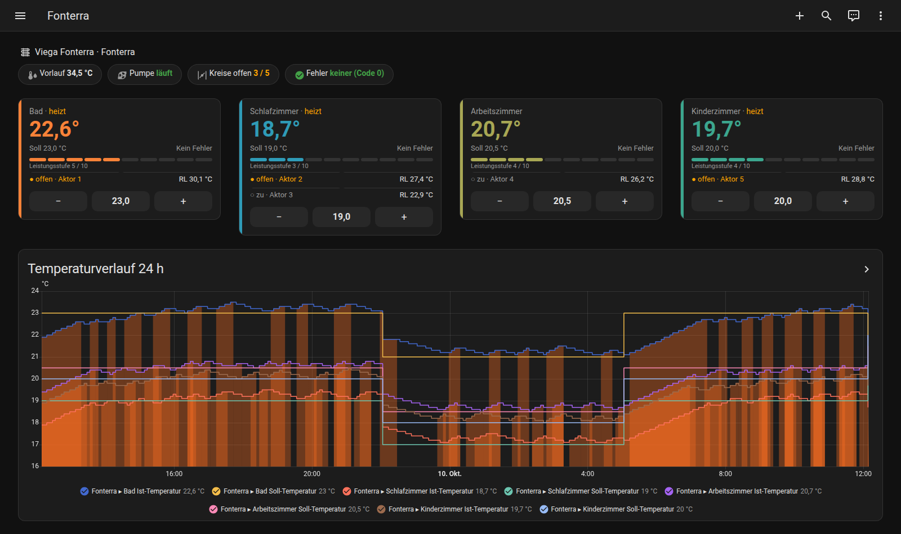

# Viega Fonterra Smart Control for Home Assistant

[](https://github.com/mikefogel/homeassistant-viega-fonterra-modbus/actions/workflows/tests.yml)
[](https://github.com/mikefogel/homeassistant-viega-fonterra-modbus/actions/workflows/validate.yml)
[](https://github.com/mikefogel/homeassistant-viega-fonterra-modbus/actions/workflows/latest-home-assistant.yml)

> **⚠️ Disclaimer — please read**
>
> This is an **independent, community-developed, unofficial** Home Assistant integration.
>
> - It is **not** created, endorsed, certified, sponsored, or supported by **Viega GmbH** or any of its affiliates, and the author has no business relationship with Viega GmbH.
> - "Viega", "Fonterra", and "Fonterra Smart Control" are trademarks of Viega GmbH, used in this repository only to identify the hardware this integration talks to (nominative use) — not to suggest any endorsement or partnership.
> - This integration was built from Viega's own **publicly published** Fonterra Smart Control user manual (see "Documentation" below) together with independent verification against real hardware (Modbus wire captures). No confidential Viega SDK, API, or internal documentation was used, and none is required to use or review this project.
> - **Use at your own risk.** This integration reads from and writes to your heating installation's Modbus interface. The author accepts no liability for damage to your heating system, property, or data arising from its use.
> - Using third-party software with your installation may affect Viega's own warranty or support terms — if in doubt, ask your installer or Viega directly.
> - Provided **"as is", without warranty of any kind, express or implied** — see the MIT license at the bottom of this file for the exact legal terms.


This custom integration connects one or more Viega Fonterra Smart Control systems to Home Assistant over local Modbus TCP. It provides room thermostats, register sensors, actuator controls, and diagnostic information.

## Features

- Multiple independently configured Viega modules
- Home Assistant UI setup and reconfiguration — no YAML editing
- Automatic room and actuator discovery straight from the device; no manual room mapping needed
- IP address or hostname and configurable Modbus TCP port
- Editable module and room names
- Room climate entities with current and target temperature
- Target-temperature writes through documented holding registers, with read-after-write verification against the device's own next reading
- Operating mode and profile mode controls, plus on/off (standby with frost protection)
- What each room is doing right now — heating, cooling, idle, or off — shown on the built-in thermostat and tile cards and as colored bands in the history graph
- Room power-level Number entities
- Flow temperature (one shared entity per module), per-actuator return temperature, and per-actuator position (open/closed)
- Derived, debounced circulation-pump indicator for driving your own pump automation, with a ready-made, one-click importable blueprint (run-on time; one pump for several modules or one pump per module), plus derived actuator statistics (open count, transition count, cumulative open time)
- Guide for daily heating time per room with Home Assistant's built-in helpers, as a bar chart per day
- WLAN module and base-unit identity diagnostics
- Base-unit error code and error status
- Automatic reconnection after a lost connection, with connection-health diagnostics and an on-demand rediscovery action for an already-running module
- Notifications under Settings → Repairs when a module is unreachable for 30 minutes or the base unit reports an error code, with the code's meaning translated
- Clear, translated error messages when a change can't be applied, in the setup dialogs and for every action
- One polling cycle per module that updates all of its entities together, with adjacent registers read in a single request
- A multi-module overview for installations with more than one Viega module
- Localized (German/English) entity names, states (e.g. "Kein Fehler"), units (power level "Stufe") and thermostat preset labels, plus fitting icons (valve for actuators, pump for the pump indicator)
- Downloadable configuration diagnostics (JSON) for checking an installation against the device
- Optional Modbus TX/RX frame-level debug logging
- Transaction-ID, function-code, and response-length validation on every Modbus frame
- Preservation of the last valid value for invalid readings (`-99`) and communication failures, even across repeated consecutive errors

## Requirements

- Home Assistant 2024.6.0 or newer (per `hacs.json`)
- A Viega Fonterra Smart Control system with Modbus TCP enabled
- Network access from Home Assistant to the WLAN module or base unit

The Fonterra manual states that Modbus TCP must be enabled in the device software (via the Fonterra Smart Control web interface or app). The default endpoint used by this integration is:

- Host: `192.168.0.188`
- Port: `502` (the manual's normal/DHCP network port; `192.168.1.1` is only used in point-to-point mode)

Both values are only defaults for the setup form — use your device's actual IP address or hostname and port, and change them any time afterward through reconfiguration.

### Verified setup

The author runs this integration in daily use on a kept-up-to-date Home Assistant instance hosted on a Raspberry Pi 4, controlling three separate Fonterra Smart Control base units (Dachgeschoss/Obergeschoss/Erdgeschoss), all currently on base-unit firmware **4.3-6.10**. This is the configuration the integration is actually developed and exercised against day to day — it isn't a compatibility guarantee for other hardware, Home Assistant versions, or firmware versions (see the disclaimer at the top of this file).

## Installation

### HACS

1. Open HACS in Home Assistant.
2. Search for **Viega Fonterra Smart Control**.
3. Install the integration.
4. Restart Home Assistant.

### Manual

Copy the `custom_components/viega_fonterra_modbus` directory into the `custom_components` directory of your Home Assistant configuration, then restart Home Assistant.

## Setup

Open **Settings > Devices & services > Add integration** and select **Viega Fonterra Smart Control**.

The setup form accepts:

| Field | Description | Default |
| --- | --- | --- |
| Host | IPv4 address or resolvable hostname of the WLAN module/base unit – a hostname such as `smart-<serial number>` keeps working when the router hands out a new IP address (see "After a Viega Fonterra firmware update") | `192.168.0.188` |
| Port | Modbus TCP port | `502` |
| Device name | The Home Assistant device name for this module | `Fonterra` |
| Polling interval | Seconds between two polling cycles of the module (all its values are read once per cycle) | `30` (range `5`–`300`) |
| Modbus timeout | Seconds to wait for a Modbus response | `5` (range `1`–`30`) |

The integration validates the connection before creating the entry. To add another Fonterra module (a second physical base unit), repeat the setup flow with that module's own host/port/device name — each module gets its own connection, device, polling configuration, and entities, and one module's failure or reload never affects another.

Example: two modules on the same Home Assistant installation:

| | Module 1 | Module 2 |
| --- | --- | --- |
| Host | `192.168.0.188` | `192.168.0.189` |
| Port | `502` | `502` |
| Device name | `Fonterra Erdgeschoss` | `Fonterra Obergeschoss` |
| Polling interval | `30` | `30` |
| Modbus timeout | `5` | `5` |

There is no room-mapping field on this form. Rooms and their actuator(s) are
discovered automatically from the device itself once it connects: the
integration reads every actuator's "Raum ID" register to see which room it
serves, and each room's own name register for its display name. This runs
again on every setup/reload, so it reflects the physical installation even
if it changes later (an actuator moved to a different room, a room renamed
on the base unit). If the device can't be reached during a particular setup
cycle, the last successfully discovered mapping is kept instead.

If discovery has never succeeded even once (for example, the device was
unreachable during the very first setup), no room, climate, or Number
entities are created and a warning is logged — there is currently no way to
type in a room mapping from scratch through the UI as a substitute. Make
sure the device is reachable and Modbus TCP is enabled before adding the
module, and reload the integration entry once it is.

Room names are used for climate, Number, sensor, and diagnostic entity names.

## Reconfiguration

Open the integration entry and select **Configure** to change the module's device name, host, port, polling interval, and Modbus timeout. For every room the device has already reported, you can also override its display name, actuator number, sensor number, and target-temperature register. The connection is tested before changes are accepted, and the integration reloads the module automatically after a successful change (which re-runs discovery and may overwrite a manual override if the device now reports something different for that room).

Entity unique IDs are based on the config entry and room ID, so renaming a module or room does not create duplicate entities.

## Entities

Depending on the discovered rooms/actuators and available registers, the integration creates (device/room names below are examples — yours will use your own configured names):

| Platform | Example entity ID | What it shows |
| --- | --- | --- |
| Climate | `climate.fonterra_wohnzimmer` | Current/target temperature, heating/cooling mode, on/off, profile mode, current activity (heating/cooling/idle/off) |
| Number | `number.fonterra_wohnzimmer_power_level` | Room actuator power level (`0`–`10`) |
| Sensor | `sensor.fonterra_flow_temperature` | Base-unit flow temperature (one entity per module) |
| Sensor | `sensor.fonterra_wohnzimmer_actuator_1_return_temperature` | One actuator's return temperature |
| Binary sensor | `binary_sensor.fonterra_wohnzimmer_actuator_1_position` | One actuator's position (open/closed) |
| Sensor | `sensor.fonterra_wlan_serial_number` / `..._base_unit_serial_number` / `..._base_unit_name` | Diagnostic identity values |
| Sensor | `sensor.fonterra_base_unit_error_code` | Raw base-unit error code + translated description |
| Binary sensor | `binary_sensor.fonterra_base_unit_error` | On when the base-unit error code is non-zero |
| Sensor | `sensor.fonterra_wohnzimmer_diagnostic` | That room's error/warning state in your language (e.g. "Kein Fehler", "Warnung: Batterie des Raumthermostats schwach"), with the raw code as attribute |
| Binary sensor | `binary_sensor.fonterra_circulation_pump` | Derived circulation-pump indicator (see below) |
| Sensor | `sensor.fonterra_last_successful_modbus_response` and eight more health sensors | Connection health metrics and invalid registers (see below; three of them are disabled by default) |
| Sensor | `sensor.fonterra_currently_open_actuators` and three more `..._actuator_stats_*` sensors | Derived actuator statistics (see below) |

Operating mode and profile mode are set on the base unit itself, not per
room — changing them from any one room's thermostat card changes them for
every room at once. This matches the physical device (there is only one
Betriebsmodus/Profilmodus register for the whole installation) and is not a
bug. The same applies to the thermostat card's on/off control: turning one
room off puts the whole module into standby (frost protection stays active),
and turning it on restores the last active mode (heating or cooling).

The profile mode (Manual/Profile/Setback) only exists in heating mode on the
device, so the preset control is shown only while the module is heating.

Each room's climate entity also reports what the room is doing right now:
**Heating**/**Cooling** while at least one of the room's actuators is open,
**Idle** while all of them are closed, and **Off** in standby. Home
Assistant's built-in thermostat and tile cards show this as text and color,
and the climate entity's history graph shows colored bands for the periods in
which the room was actually heating or cooling.

The Fonterra register map uses signed 16-bit input values. Temperatures are scaled according to the manual: room and target temperatures use tenths of a degree Celsius, as do flow and return temperatures. The integration converts these values before exposing them to Home Assistant.

### Circulation pump indicator

`binary_sensor.<device>_circulation_pump` (one per module, device class "running") is a **derived** indicator, not a device register — the Fonterra base unit has no circulation-pump register at all. It is:

- **on** when at least one of the module's used actuators (one actually assigned to a room by discovery) is confirmed open
- **off** once every used actuator is confirmed closed
- **unknown/unavailable** until the first actuator has settled

Every actuator's raw open/closed reading is debounced before it can affect this entity: a reading only counts once the actuator's position register has returned the *same* value in 3 consecutive polling cycles, so a single noisy or transitional reading cannot flip the pump. A failed read or a `-99` value is skipped — it neither advances nor resets that actuator's debounce counter.

This entity writes nothing back to the device and does not control anything on the Fonterra system. It is meant to drive your own automation for a circulation pump that is wired and switched independently (e.g. via a smart relay).

The easiest way is the ready-made blueprint — import it, pick the indicator and your pump switch, and set a run-on time (default 5 minutes):

[](https://my.home-assistant.io/redirect/blueprint_import/?blueprint_url=https%3A%2F%2Fgithub.com%2Fmikefogel%2Fhomeassistant-viega-fonterra-modbus%2Fblob%2Fmain%2Fblueprints%2Fautomation%2Fviega_fonterra_modbus%2Fcirculation_pump.yaml)

The pump turns on as soon as any actuator opens and off once all actuators have stayed closed for the run-on time; if an actuator opens again in between, the pump simply keeps running. After a Home Assistant restart with open actuators it is switched on right away, and while an indicator is unavailable the pump is not switched off. ([Blueprint source](blueprints/automation/viega_fonterra_modbus/circulation_pump.yaml))

**Setting it up, step by step**

1. Click the button above (or go to *Settings → Automations & scenes → Blueprints → Import blueprint* and paste the blueprint's URL), then **Import blueprint**.
2. In the blueprint list, open **Viega Fonterra – circulation pump** and choose **Create automation**.
3. **Circulation-pump indicator(s):** pick the "Circulation pump" sensor of every Viega module whose heating circuits this pump supplies.
4. **Pump switch:** pick the switch or relay that powers the pump.
5. **Run-on time:** how long the pump keeps running after the last actuator has closed (default 5 minutes).
6. Save the automation and give it a name, e.g. "Heizkreispumpe".

Which indicators to pick depends on how your pumps are wired. With three modules, one per floor, e.g. `binary_sensor.dachgeschoss_umwalzpumpe`, `binary_sensor.obergeschoss_umwalzpumpe` and `binary_sensor.erdgeschoss_umwalzpumpe`:

- **One pump for the whole house:** create **one** automation and select **all three** indicators. The pump runs while any floor needs heat and switches off once every floor has been closed for the run-on time.
- **One pump per floor:** create **three** automations, each with **one** floor's indicator and that floor's pump switch.

If you prefer a plain automation without run-on time:

```yaml
automation:
  - alias: "Heizkreispumpe folgt Fonterra-Aktoren"
    trigger:
      - platform: state
        entity_id: binary_sensor.fonterra_circulation_pump
    condition:
      - condition: template
        value_template: "{{ trigger.to_state.state in ['on', 'off'] }}"
    action:
      - service: switch.turn_{{ 'on' if trigger.to_state.state == 'on' else 'off' }}
        target:
          entity_id: switch.heizkreispumpe
```

### Connection health metrics

Each module also exposes nine diagnostic sensors derived entirely from the integration's own bookkeeping — none of them issues an extra Modbus request:

- last successful response timestamp
- last failed request timestamp
- consecutive communication-failure count
- invalid-value count (including the `-99` sentinel)
- last Modbus exception code, when available
- duration of the most recent successful request
- number of automatic reconnections, and the time of the last one
- **invalid registers**: how many registers the device reported as `-99` in the latest polling cycle, with the list of them (e.g. `room_3.current_temperature`) as an attribute

These are diagnostic only: a communication failure never overwrites a room's last valid value, and no host/port/network information is exposed through them.

**Last successful response**, **duration of the last request**, and the **invalid-value count** change on every polling cycle (the count does whenever a register is permanently `-99`), so they are **disabled by default** to keep your database small (see "Keeping the database small" below). Enable them under *Settings → Devices & services → Entities* if you want them; the others only change on failures, reconnections, or when the set of invalid registers changes.

### Repairs notifications

Problems that need your attention show up under **Settings → Repairs**, so you notice them even without looking at the dashboard:

- **Module not reachable** — no response from a module for 30 minutes.
- **Base-unit error** — the base unit reports an error code, with the code's meaning from the Viega manual (e.g. "Replace the backup battery"). Warnings such as a weak thermostat battery are shown as warnings, faults as errors.

Both disappear on their own once the problem is gone. They use only values the integration already reads.

### Automatic reconnection

If the connection to a module drops — the base unit or WLAN module restarts, the Wi-Fi or router goes down, or the device closes the connection — the integration reconnects on its own as soon as the module is reachable again; no reload is needed. While the module is unreachable, every entity keeps its last valid value. Reconnection attempts back off from 5 seconds up to the module's polling interval, a read that hit a broken connection is retried once on the new connection, and writes are never repeated automatically. The log shows one warning when the connection is lost and one info message when it is restored.

### Rediscovering the topology on demand

Beyond the automatic discovery that runs on every setup (see "Setup" above), you can trigger a rediscovery of an already-running module at any time with the `viega_fonterra_modbus.rediscover` service (Developer Tools → Actions), targeting the module's device. It re-reads the actuator Raum-ID and room-name registers, compares the result with the currently loaded topology, and updates entities in place — added, removed, renamed, or reassigned rooms and actuators are logged and reported as a `viega_fonterra_modbus_rediscovery` event — without reloading the config entry or reconnecting. If the device can't be read during the rediscovery attempt, the previously working topology is left untouched and the action reports a translated error message instead of failing silently.

### Write verification

After writing a target temperature, operating mode, profile mode, or power level, the integration starts a polling cycle right away and checks the device's own next valid read of that register against what was written. If the device reports something else (a rejected or overridden write), the displayed value is reconciled to what the device actually reports and a warning is logged — the device's value is always authoritative.

### One polling cycle per module

Each module is read in one polling cycle per polling interval: the integration reads every value the module's entities need and then updates all of them together — entities are not polled by Home Assistant one by one. After you change a value (temperature, mode, preset, power level) the next cycle runs right away, so the device's own value shows up within seconds instead of after a full interval.

Within a cycle, registers that are adjacent on the device (e.g. two rooms' power-level/target-temperature registers, or one actuator's position/return-temperature registers) are read with a single Modbus request. Input and holding registers are never combined, and an undocumented gap between two registers is never bridged. If one of these requests fails, only its values are skipped for that cycle: the affected entities keep their last valid values and stay available, and the next cycle tries again.

### Extended diagnostics snapshot

The "Download diagnostics" export (see "Verifying your configuration" below) also includes a small, bounded `extended` section: the connection-health counters above plus a short history of recent Modbus exception codes, the exact documented register addresses a normal polling cycle reads for your topology, and the most recent rediscovery's added/removed/renamed/reassigned diff, if any. It contains no host/IP/credential data and no firmware/version guesses — the device doesn't document a version register, so none is fabricated.

### Derived actuator statistics

Four more diagnostic sensors are derived from the circulation-pump indicator's own debounced actuator readings, without any extra Modbus traffic:

- number of actuators currently confirmed open
- confirmed open-transition count (how many times the pump indicator has turned on)
- timestamp of the last confirmed transition (on↔off)
- cumulative confirmed-open time

These are computed values, not device registers, and are not a substitute for the circulation-pump binary sensor itself. The cumulative open time grows once per open period, when it ends, not on every cycle. The open-actuator count stays unavailable until at least one actuator has completed its debounce cycle and is never restored to a stale value after a restart; the transition count, cumulative open time, and last-transition timestamp are restored and continue counting from there.

### Multi-module overview

If you have more than one Viega Fonterra module configured, the `viega_fonterra_modbus.overview` service (Developer Tools → Actions, "response data" enabled) returns a per-module summary in one call: reachability, whether a base-unit error is active, whether communication looks stale or failed, and the room/actuator count — all without any extra Modbus read. Two modules' same-named rooms (e.g. both called "Wohnzimmer") are never merged: every room and every module in the response always carries its own config entry ID. One module's failure while building the summary never affects another module's entry in the response.

## Example dashboards

Three complete dashboards to start from. All screenshots are taken from a real Home Assistant 2026.10 running this integration against a simulated, anonymous module ("Fonterra" with the rooms Bad, Schlafzimmer, Arbeitszimmer, and Kinderzimmer, five heating circuits, 24 hours of history) – they show exactly what the YAML below produces. They are re-rendered with [`tools/dashboard-screenshots/render.sh`](tools/dashboard-screenshots/render.sh); the YAML lives in [`docs/dashboards/`](docs/dashboards/).

**Using one:** *Settings → Dashboards → Add dashboard → New dashboard from scratch*, open it, then *⋮ → Edit dashboard → ⋮ → Raw configuration editor*, paste the YAML, and replace the entity IDs with your own. Entity IDs follow `<domain>.<device_name>_<room_name>[...]` in the language Home Assistant had when the entities were created – a German installation gets e.g. `binary_sensor.dachgeschoss_umwalzpumpe` instead of `..._circulation_pump`. Look them up under *Developer tools → States*, filtered by your device name. Labels such as "Heating", "Open", or "No error" appear in your own language.

### 1. Standard – built-in cards

One thermostat card per room with its details, actuators, and a combined temperature history. Works on every supported Home Assistant version.



<details>
<summary>YAML</summary>

```yaml
title: Heating
views:
  - title: Overview
    path: heating-overview
    icon: mdi:radiator
    cards:
      - type: markdown
        content: "## Viega Fonterra – Fonterra"

      - type: entities
        title: Module status
        entities:
          - entity: sensor.fonterra_flow_temperature
            name: Flow temperature
          - entity: binary_sensor.fonterra_circulation_pump
            name: Circulation pump
          - entity: sensor.fonterra_base_unit_error_code
            name: Error code
          - entity: binary_sensor.fonterra_base_unit_error
            name: Error active

      - type: entities
        title: Diagnostics (module)
        entities:
          - entity: sensor.fonterra_base_unit_name
          - entity: sensor.fonterra_base_unit_serial_number
          - entity: sensor.fonterra_wlan_module_serial_number

      # --- Bad (1 actuator) ------------------------------------------------
      - type: vertical-stack
        cards:
          - type: thermostat
            entity: climate.fonterra_bad
          - type: entities
            title: Bad details
            entities:
              - entity: number.fonterra_bad_power_level
                name: Power level
              - entity: sensor.fonterra_bad_diagnostic
                name: Diagnostic
          - type: glance
            title: Bad actuator
            entities:
              - entity: binary_sensor.fonterra_bad_actuator_1_position
                name: Actuator 1
              - entity: sensor.fonterra_bad_actuator_1_return_temperature
                name: Return 1

      # --- Schlafzimmer (2 actuators) --------------------------------------
      - type: vertical-stack
        cards:
          - type: thermostat
            entity: climate.fonterra_schlafzimmer
          - type: entities
            title: Schlafzimmer details
            entities:
              - entity: number.fonterra_schlafzimmer_power_level
                name: Power level
              - entity: sensor.fonterra_schlafzimmer_diagnostic
                name: Diagnostic
          - type: glance
            title: Schlafzimmer actuators
            entities:
              - entity: binary_sensor.fonterra_schlafzimmer_actuator_2_position
                name: Actuator 2
              - entity: sensor.fonterra_schlafzimmer_actuator_2_return_temperature
                name: Return 2
              - entity: binary_sensor.fonterra_schlafzimmer_actuator_3_position
                name: Actuator 3
              - entity: sensor.fonterra_schlafzimmer_actuator_3_return_temperature
                name: Return 3

      # --- Arbeitszimmer (1 actuator) --------------------------------------
      - type: vertical-stack
        cards:
          - type: thermostat
            entity: climate.fonterra_arbeitszimmer
          - type: entities
            title: Arbeitszimmer details
            entities:
              - entity: number.fonterra_arbeitszimmer_power_level
                name: Power level
              - entity: sensor.fonterra_arbeitszimmer_diagnostic
                name: Diagnostic
          - type: glance
            title: Arbeitszimmer actuator
            entities:
              - entity: binary_sensor.fonterra_arbeitszimmer_actuator_4_position
                name: Actuator 4
              - entity: sensor.fonterra_arbeitszimmer_actuator_4_return_temperature
                name: Return 4

      # --- Kinderzimmer (1 actuator) ---------------------------------------
      - type: vertical-stack
        cards:
          - type: thermostat
            entity: climate.fonterra_kinderzimmer
          - type: entities
            title: Kinderzimmer details
            entities:
              - entity: number.fonterra_kinderzimmer_power_level
                name: Power level
              - entity: sensor.fonterra_kinderzimmer_diagnostic
                name: Diagnostic
          - type: glance
            title: Kinderzimmer actuator
            entities:
              - entity: binary_sensor.fonterra_kinderzimmer_actuator_5_position
                name: Actuator 5
              - entity: sensor.fonterra_kinderzimmer_actuator_5_return_temperature
                name: Return 5

      - type: history-graph
        title: Temperature history
        hours_to_show: 24
        entities:
          - entity: climate.fonterra_bad
          - entity: climate.fonterra_schlafzimmer
          - entity: climate.fonterra_arbeitszimmer
          - entity: climate.fonterra_kinderzimmer
```

</details>

### 2. Tiles – built-in cards

A compact overview with one column per room: activity and temperature, target −/+, every actuator with its return temperature, and the room diagnostic; module status as badges at the top. Uses the *sections* view, badges, and the heading card (Home Assistant 2024.10 or newer).



<details>
<summary>YAML</summary>

```yaml
title: Heating
views:
  - title: Fonterra
    path: fonterra
    icon: mdi:radiator
    type: sections
    max_columns: 4
    # Labelled module status badges at the top of the view
    badges:
      - type: entity
        entity: sensor.fonterra_flow_temperature
        name: Flow
        show_name: true
      - type: entity
        entity: binary_sensor.fonterra_circulation_pump
        name: Pump
        show_name: true
      - type: entity
        entity: sensor.fonterra_currently_open_actuators
        name: Circuits open
        show_name: true
      - type: entity
        entity: binary_sensor.fonterra_base_unit_error
        name: Error
        show_name: true
    sections:
      - type: grid
        column_span: 4
        cards:
          - type: heading
            heading: Viega Fonterra – Fonterra
            heading_style: title

      # One section per room: copy it and replace the room part of the IDs
      - type: grid
        cards:
          - type: tile
            entity: climate.fonterra_bad
            name: Bad
            vertical: false
            state_content:
              - hvac_action
              - current_temperature
            features:
              - type: target-temperature
          - type: tile
            entity: binary_sensor.fonterra_bad_actuator_1_position
            name: Actuator 1
          - type: tile
            entity: sensor.fonterra_bad_actuator_1_return_temperature
            name: Return 1
          - type: tile
            entity: sensor.fonterra_bad_diagnostic
            name: Diagnostic

      - type: grid
        cards:
          - type: tile
            entity: climate.fonterra_schlafzimmer
            name: Schlafzimmer
            vertical: false
            state_content:
              - hvac_action
              - current_temperature
            features:
              - type: target-temperature
          - type: tile
            entity: binary_sensor.fonterra_schlafzimmer_actuator_2_position
            name: Actuator 2
          - type: tile
            entity: sensor.fonterra_schlafzimmer_actuator_2_return_temperature
            name: Return 2
          - type: tile
            entity: binary_sensor.fonterra_schlafzimmer_actuator_3_position
            name: Actuator 3
          - type: tile
            entity: sensor.fonterra_schlafzimmer_actuator_3_return_temperature
            name: Return 3
          - type: tile
            entity: sensor.fonterra_schlafzimmer_diagnostic
            name: Diagnostic

      - type: grid
        cards:
          - type: tile
            entity: climate.fonterra_arbeitszimmer
            name: Arbeitszimmer
            vertical: false
            state_content:
              - hvac_action
              - current_temperature
            features:
              - type: target-temperature
          - type: tile
            entity: binary_sensor.fonterra_arbeitszimmer_actuator_4_position
            name: Actuator 4
          - type: tile
            entity: sensor.fonterra_arbeitszimmer_actuator_4_return_temperature
            name: Return 4
          - type: tile
            entity: sensor.fonterra_arbeitszimmer_diagnostic
            name: Diagnostic

      - type: grid
        cards:
          - type: tile
            entity: climate.fonterra_kinderzimmer
            name: Kinderzimmer
            vertical: false
            state_content:
              - hvac_action
              - current_temperature
            features:
              - type: target-temperature
          - type: tile
            entity: binary_sensor.fonterra_kinderzimmer_actuator_5_position
            name: Actuator 5
          - type: tile
            entity: sensor.fonterra_kinderzimmer_actuator_5_return_temperature
            name: Return 5
          - type: tile
            entity: sensor.fonterra_kinderzimmer_diagnostic
            name: Diagnostic

      # Temperature history of every room across the full width
      - type: grid
        column_span: 4
        cards:
          - type: history-graph
            title: Temperature history (24 h)
            grid_options:
              columns: full
            hours_to_show: 24
            entities:
              - entity: climate.fonterra_bad
              - entity: climate.fonterra_schlafzimmer
              - entity: climate.fonterra_arbeitszimmer
              - entity: climate.fonterra_kinderzimmer
```

</details>

### 3. Tiles with button-card (HACS, German)

A denser, styled layout contributed from a real installation (anonymised): status chips for flow temperature, pump, open circuits, and base-unit error; one card per room with the temperature coloured from blue to red, target and diagnostic, a ten-step power-level bar, every actuator with its return temperature, and −/target/+ buttons; plus the 24-hour history. **Optional and not part of this integration:** it needs the [button-card](https://github.com/custom-cards/button-card) frontend card from HACS (tested with 7.0.1). Its labels ("Vorlauf", "Pumpe läuft", "Soll", "RL", ...) are written in German inside the card templates, and the entity IDs are those of a German installation, so the screenshot is taken in German. Everything else in this README works with built-in cards only.



<details>
<summary>YAML</summary>

```yaml
# Requires the button-card frontend card from HACS (tested with 7.0.1):
# https://github.com/custom-cards/button-card
# Labels are German and the entity IDs those of a German Home Assistant
# installation (module "Fonterra"); adapt both to your installation.
title: Heizung
views:
- type: sections
  max_columns: 4
  title: Fonterra
  path: fonterra
  icon: mdi:radiator
  sections:
  - type: grid
    column_span: 4
    cards:
    - type: heading
      heading: Viega Fonterra · Fonterra
      heading_style: title
      icon: mdi:heating-coil
    - type: custom:button-card
      show_name: false
      show_icon: false
      show_state: false
      tap_action:
        action: none
      styles:
        card:
        - background: none
        - box-shadow: none
        - border: none
        - padding: '0'
        grid:
        - display: flex
        - flex-wrap: wrap
        - gap: 10px
        custom_fields:
          p1:
          - width: auto
          p2:
          - width: auto
          p3:
          - width: auto
          p4:
          - width: auto
      custom_fields:
        p1:
          card:
            type: custom:button-card
            entity: sensor.fonterra_vorlauftemperatur
            show_name: false
            show_icon: false
            show_state: false
            tap_action:
              action: more-info
            styles:
              card:
              - background: none
              - box-shadow: none
              - border: none
              - border-radius: 6px
              - padding: '0'
              - background: var(--ha-card-background,var(--card-background-color))
              - border: 1px solid var(--divider-color)
              - border-radius: 20px
              - padding: 7px 16px
              - width: auto
              grid:
              - grid-template-areas: '"v"'
              custom_fields:
                v:
                - justify-self: stretch
                - text-align: left
                - font-size: 14px
                - white-space: nowrap
            custom_fields:
              v: |
                [[[[
                const v=parseFloat(entity.state);
                return `<ha-icon icon="mdi:thermometer-water" style="--mdc-icon-size:18px;color:var(--secondary-text-color);vertical-align:-3px"></ha-icon> Vorlauf <b>${isNaN(v)?'–':v.toFixed(1).replace('.',',')+' °C'}</b>`;
                ]]]]
        p2:
          card:
            type: custom:button-card
            entity: binary_sensor.fonterra_umwalzpumpe
            show_name: false
            show_icon: false
            show_state: false
            tap_action:
              action: more-info
            styles:
              card:
              - background: none
              - box-shadow: none
              - border: none
              - border-radius: 6px
              - padding: '0'
              - background: var(--ha-card-background,var(--card-background-color))
              - border: 1px solid var(--divider-color)
              - border-radius: 20px
              - padding: 7px 16px
              - width: auto
              grid:
              - grid-template-areas: '"v"'
              custom_fields:
                v:
                - justify-self: stretch
                - text-align: left
                - font-size: 14px
                - white-space: nowrap
            custom_fields:
              v: |
                [[[[
                const on=entity.state==='on';const c=on?'var(--success-color,#4caf50)':'var(--primary-text-color)';
                return `<ha-icon icon="mdi:pump" style="--mdc-icon-size:18px;color:var(--secondary-text-color);vertical-align:-3px"></ha-icon> Pumpe <b style="color:${c}">${on?'läuft':'aus'}</b>`;
                ]]]]
        p3:
          card:
            type: custom:button-card
            entity: sensor.fonterra_aktuell_geoffnete_aktoren
            show_name: false
            show_icon: false
            show_state: false
            tap_action:
              action: more-info
            styles:
              card:
              - background: none
              - box-shadow: none
              - border: none
              - border-radius: 6px
              - padding: '0'
              - background: var(--ha-card-background,var(--card-background-color))
              - border: 1px solid var(--divider-color)
              - border-radius: 20px
              - padding: 7px 16px
              - width: auto
              grid:
              - grid-template-areas: '"v"'
              custom_fields:
                v:
                - justify-self: stretch
                - text-align: left
                - font-size: 14px
                - white-space: nowrap
            custom_fields:
              v: |
                [[[[
                const n=parseFloat(entity.state);const c=n>0?'var(--warning-color,#ffa726)':'var(--primary-text-color)';
                return `<ha-icon icon="mdi:valve" style="--mdc-icon-size:18px;color:var(--secondary-text-color);vertical-align:-3px"></ha-icon> Kreise offen <b style="color:${c}">${isNaN(n)?'–':n} / 5</b>`;
                ]]]]
        p4:
          card:
            type: custom:button-card
            entity: binary_sensor.fonterra_basiseinheit_fehler
            show_name: false
            show_icon: false
            show_state: false
            tap_action:
              action: more-info
            styles:
              card:
              - background: none
              - box-shadow: none
              - border: none
              - border-radius: 6px
              - padding: '0'
              - background: var(--ha-card-background,var(--card-background-color))
              - border: 1px solid var(--divider-color)
              - border-radius: 20px
              - padding: 7px 16px
              - width: auto
              grid:
              - grid-template-areas: '"v"'
              custom_fields:
                v:
                - justify-self: stretch
                - text-align: left
                - font-size: 14px
                - white-space: nowrap
            custom_fields:
              v: |
                [[[[
                const err=entity.state==='on';const cs=states['sensor.fonterra_basiseinheit_fehlercode'];const code=cs?cs.state:'–';
                const c=err?'var(--error-color,#f44336)':'var(--success-color,#4caf50)';
                return `<ha-icon icon="${err?'mdi:alert-circle':'mdi:check-circle'}" style="--mdc-icon-size:18px;color:${c};vertical-align:-3px"></ha-icon> Fehler <b style="color:${c}">${err?'Code '+code:'keiner (Code '+code+')'}</b>`;
                ]]]]
      grid_options:
        columns: full
  - type: grid
    cards:
    - type: custom:button-card
      show_name: false
      show_icon: false
      show_state: false
      tap_action:
        action: none
      styles:
        card:
        - padding: 14px 14px 14px 19px
        - position: relative
        - overflow: hidden
        grid:
        - grid-template-areas: '"title title" "ist ist" "soll diag" "stufe stufe" "a1 r1" "btn btn"'
        - grid-template-columns: 1fr 1fr
        - row-gap: 4px
        custom_fields:
          accent:
          - width: 100%
          - justify-self: stretch
          - position: absolute
          - left: '0'
          - top: '0'
          - bottom: '0'
          - width: 5px
          title:
          - width: 100%
          - justify-self: stretch
          ist:
          - width: 100%
          - justify-self: stretch
          soll:
          - width: 100%
          - justify-self: stretch
          diag:
          - width: 100%
          - justify-self: stretch
          stufe:
          - width: 100%
          - justify-self: stretch
          a1:
          - width: 100%
          - justify-self: stretch
          r1:
          - width: 100%
          - justify-self: stretch
          btn:
          - width: 100%
          - justify-self: stretch
          - margin-top: 6px
      custom_fields:
        accent: |
          [[[
          const s=[[17,[66,133,244]],[19.5,[38,166,154]],[21.5,[255,167,38]],[24,[239,83,80]]];
          const col=(t)=>{if(isNaN(t))return 'var(--secondary-text-color)';if(t<=s[0][0])return `rgb(${s[0][1]})`;
            for(let i=1;i<s.length;i++){if(t<=s[i][0]){const f=(t-s[i-1][0])/(s[i][0]-s[i-1][0]);
            return `rgb(${s[i-1][1].map((v,k)=>Math.round(v+(s[i][1][k]-v)*f))})`;}}return `rgb(${s[3][1]})`;};
          const f1=(v)=>isNaN(v)?'–':Number(v).toFixed(1).replace('.',',');
          return `<div style="width:5px;height:100%;background:${col(parseFloat(entity.attributes.current_temperature))}"></div>`;
          ]]]
        title:
          card:
            type: custom:button-card
            entity: climate.fonterra_bad
            show_name: false
            show_icon: false
            show_state: false
            tap_action:
              action: more-info
            styles:
              card:
              - background: none
              - box-shadow: none
              - border: none
              - border-radius: 6px
              - padding: '0'
              grid:
              - grid-template-areas: '"v"'
              custom_fields:
                v:
                - justify-self: stretch
                - text-align: left
                - font-size: 14px
                - color: var(--secondary-text-color)
            custom_fields:
              v: |
                [[[[
                const h=entity.attributes.hvac_action==='heating';
                return 'Bad'+(h?' · <span style="color:var(--warning-color,#ffa726)">heizt</span>':entity.state==='off'?' · Standby':'');
                ]]]]
        ist:
          card:
            type: custom:button-card
            entity: climate.fonterra_bad
            show_name: false
            show_icon: false
            show_state: false
            tap_action:
              action: more-info
            styles:
              card:
              - background: none
              - box-shadow: none
              - border: none
              - border-radius: 6px
              - padding: '0'
              grid:
              - grid-template-areas: '"v"'
              custom_fields:
                v:
                - justify-self: stretch
                - text-align: left
                - font-size: 38px
                - font-weight: '700'
                - line-height: '1.1'
            custom_fields:
              v: |
                [[[[
                const s=[[17,[66,133,244]],[19.5,[38,166,154]],[21.5,[255,167,38]],[24,[239,83,80]]];
                const col=(t)=>{if(isNaN(t))return 'var(--secondary-text-color)';if(t<=s[0][0])return `rgb(${s[0][1]})`;
                  for(let i=1;i<s.length;i++){if(t<=s[i][0]){const f=(t-s[i-1][0])/(s[i][0]-s[i-1][0]);
                  return `rgb(${s[i-1][1].map((v,k)=>Math.round(v+(s[i][1][k]-v)*f))})`;}}return `rgb(${s[3][1]})`;};
                const f1=(v)=>isNaN(v)?'–':Number(v).toFixed(1).replace('.',',');
                const t=parseFloat(entity.attributes.current_temperature);return `<span style="color:${col(t)}">${f1(t)}°</span>`;
                ]]]]
        soll:
          card:
            type: custom:button-card
            entity: climate.fonterra_bad
            show_name: false
            show_icon: false
            show_state: false
            tap_action:
              action: more-info
            styles:
              card:
              - background: none
              - box-shadow: none
              - border: none
              - border-radius: 6px
              - padding: '0'
              grid:
              - grid-template-areas: '"v"'
              custom_fields:
                v:
                - justify-self: stretch
                - text-align: left
                - font-size: 13px
                - color: var(--secondary-text-color)
            custom_fields:
              v: |
                [[[[
                const t=parseFloat(entity.attributes.temperature);return `Soll ${isNaN(t)?'–':t.toFixed(1).replace('.',',')} °C`;
                ]]]]
        diag:
          card:
            type: custom:button-card
            entity: sensor.fonterra_bad_diagnose
            show_name: false
            show_icon: false
            show_state: false
            tap_action:
              action: more-info
            styles:
              card:
              - background: none
              - box-shadow: none
              - border: none
              - border-radius: 6px
              - padding: '0'
              grid:
              - grid-template-areas: '"v"'
              custom_fields:
                v:
                - justify-self: stretch
                - text-align: left
                - font-size: 13px
                - color: var(--secondary-text-color)
                - text-align: right
            custom_fields:
              v: |
                [[[[
                const s=entity.state;
                if(s==='no_error')return 'Kein Fehler';
                if(s==='sensor_invalid')return '<span style="color:var(--error-color,#f44336)">Sensor ungültig</span>';
                return `<span style="color:var(--error-color,#f44336)">Fehler ${entity.attributes.error_code ?? s}</span>`;
                ]]]]
        stufe:
          card:
            type: custom:button-card
            entity: number.fonterra_bad_leistungsstufe
            show_name: false
            show_icon: false
            show_state: false
            tap_action:
              action: more-info
            styles:
              card:
              - background: none
              - box-shadow: none
              - border: none
              - border-radius: 6px
              - padding: '0'
              grid:
              - grid-template-areas: '"v"'
              custom_fields:
                v:
                - justify-self: stretch
                - text-align: left
            custom_fields:
              v: |
                [[[[
                const s=[[17,[66,133,244]],[19.5,[38,166,154]],[21.5,[255,167,38]],[24,[239,83,80]]];
                const col=(t)=>{if(isNaN(t))return 'var(--secondary-text-color)';if(t<=s[0][0])return `rgb(${s[0][1]})`;
                  for(let i=1;i<s.length;i++){if(t<=s[i][0]){const f=(t-s[i-1][0])/(s[i][0]-s[i-1][0]);
                  return `rgb(${s[i-1][1].map((v,k)=>Math.round(v+(s[i][1][k]-v)*f))})`;}}return `rgb(${s[3][1]})`;};
                const f1=(v)=>isNaN(v)?'–':Number(v).toFixed(1).replace('.',',');
                const n=Math.round(parseFloat(entity.state));const cl=states['climate.fonterra_bad'];
                const c=col(cl?parseFloat(cl.attributes.current_temperature):NaN);
                let h='<div style="display:flex;gap:3px;margin:6px 0 2px">';
                for(let i=1;i<=10;i++)h+=`<i style="flex:1;height:6px;border-radius:3px;background:${i<=n?c:'var(--divider-color)'}"></i>`;
                return h+`</div><div style="font-size:11px;color:var(--secondary-text-color)">Leistungsstufe ${isNaN(n)?'–':n} / 10</div>`;
                ]]]]
        a1:
          card:
            type: custom:button-card
            entity: binary_sensor.fonterra_bad_aktor_1_stellung
            show_name: false
            show_icon: false
            show_state: false
            tap_action:
              action: more-info
            styles:
              card:
              - background: none
              - box-shadow: none
              - border: none
              - border-radius: 6px
              - padding: '0'
              grid:
              - grid-template-areas: '"v"'
              custom_fields:
                v:
                - justify-self: stretch
                - text-align: left
                - font-size: 13px
            custom_fields:
              v: |
                [[[[
                const o=entity.state==='on';const c=o?'var(--warning-color,#ffa726)':'var(--secondary-text-color)';
                return `<div style="padding:4px 0;border-top:1px solid var(--divider-color);color:${c}">${o?'● offen':'○ zu'} · Aktor 1</div>`;
                ]]]]
        r1:
          card:
            type: custom:button-card
            entity: sensor.fonterra_bad_aktor_1_rucklauftemperatur
            show_name: false
            show_icon: false
            show_state: false
            tap_action:
              action: more-info
            styles:
              card:
              - background: none
              - box-shadow: none
              - border: none
              - border-radius: 6px
              - padding: '0'
              grid:
              - grid-template-areas: '"v"'
              custom_fields:
                v:
                - justify-self: stretch
                - text-align: left
                - font-size: 13px
            custom_fields:
              v: |
                [[[[
                const v=parseFloat(entity.state);
                return `<div style="padding:4px 0;border-top:1px solid var(--divider-color);text-align:right">RL ${isNaN(v)?'–':v.toFixed(1).replace('.',',')} °C</div>`;
                ]]]]
        btn:
          card:
            type: grid
            columns: 3
            square: false
            cards:
            - type: custom:button-card
              entity: climate.fonterra_bad
              show_icon: false
              show_state: false
              name: −
              styles:
                card:
                - height: 36px
                - border-radius: 10px
                - box-shadow: none
                - border: none
                - background: var(--secondary-background-color)
                name:
                - font-size: 18px
              tap_action:
                action: perform-action
                perform_action: climate.set_temperature
                target:
                  entity_id: climate.fonterra_bad
                data:
                  temperature: |
                    [[[[
                    const t=parseFloat(entity.attributes.temperature);
                    return Math.min(30,Math.max(5,(isNaN(t)?20:t)-0.5));
                    ]]]]
            - type: custom:button-card
              entity: climate.fonterra_bad
              show_icon: false
              show_state: false
              name: |
                [[[[
                const t=parseFloat(entity.attributes.temperature);return isNaN(t)?'–':t.toFixed(1).replace('.',',');
                ]]]]
              tap_action:
                action: more-info
              styles:
                card:
                - height: 36px
                - border-radius: 10px
                - box-shadow: none
                - border: none
                - background: var(--secondary-background-color)
                name:
                - font-size: 16px
                - font-weight: '600'
                - justify-self: center
            - type: custom:button-card
              entity: climate.fonterra_bad
              show_icon: false
              show_state: false
              name: +
              styles:
                card:
                - height: 36px
                - border-radius: 10px
                - box-shadow: none
                - border: none
                - background: var(--secondary-background-color)
                name:
                - font-size: 18px
              tap_action:
                action: perform-action
                perform_action: climate.set_temperature
                target:
                  entity_id: climate.fonterra_bad
                data:
                  temperature: |
                    [[[[
                    const t=parseFloat(entity.attributes.temperature);
                    return Math.min(30,Math.max(5,(isNaN(t)?20:t)+0.5));
                    ]]]]
      entity: climate.fonterra_bad
      grid_options:
        columns: full
  - type: grid
    cards:
    - type: custom:button-card
      show_name: false
      show_icon: false
      show_state: false
      tap_action:
        action: none
      styles:
        card:
        - padding: 14px 14px 14px 19px
        - position: relative
        - overflow: hidden
        grid:
        - grid-template-areas: '"title title" "ist ist" "soll diag" "stufe stufe" "a2 r2" "a3 r3" "btn btn"'
        - grid-template-columns: 1fr 1fr
        - row-gap: 4px
        custom_fields:
          accent:
          - width: 100%
          - justify-self: stretch
          - position: absolute
          - left: '0'
          - top: '0'
          - bottom: '0'
          - width: 5px
          title:
          - width: 100%
          - justify-self: stretch
          ist:
          - width: 100%
          - justify-self: stretch
          soll:
          - width: 100%
          - justify-self: stretch
          diag:
          - width: 100%
          - justify-self: stretch
          stufe:
          - width: 100%
          - justify-self: stretch
          a2:
          - width: 100%
          - justify-self: stretch
          r2:
          - width: 100%
          - justify-self: stretch
          a3:
          - width: 100%
          - justify-self: stretch
          r3:
          - width: 100%
          - justify-self: stretch
          btn:
          - width: 100%
          - justify-self: stretch
          - margin-top: 6px
      custom_fields:
        accent: |
          [[[
          const s=[[17,[66,133,244]],[19.5,[38,166,154]],[21.5,[255,167,38]],[24,[239,83,80]]];
          const col=(t)=>{if(isNaN(t))return 'var(--secondary-text-color)';if(t<=s[0][0])return `rgb(${s[0][1]})`;
            for(let i=1;i<s.length;i++){if(t<=s[i][0]){const f=(t-s[i-1][0])/(s[i][0]-s[i-1][0]);
            return `rgb(${s[i-1][1].map((v,k)=>Math.round(v+(s[i][1][k]-v)*f))})`;}}return `rgb(${s[3][1]})`;};
          const f1=(v)=>isNaN(v)?'–':Number(v).toFixed(1).replace('.',',');
          return `<div style="width:5px;height:100%;background:${col(parseFloat(entity.attributes.current_temperature))}"></div>`;
          ]]]
        title:
          card:
            type: custom:button-card
            entity: climate.fonterra_schlafzimmer
            show_name: false
            show_icon: false
            show_state: false
            tap_action:
              action: more-info
            styles:
              card:
              - background: none
              - box-shadow: none
              - border: none
              - border-radius: 6px
              - padding: '0'
              grid:
              - grid-template-areas: '"v"'
              custom_fields:
                v:
                - justify-self: stretch
                - text-align: left
                - font-size: 14px
                - color: var(--secondary-text-color)
            custom_fields:
              v: |
                [[[[
                const h=entity.attributes.hvac_action==='heating';
                return 'Schlafzimmer'+(h?' · <span style="color:var(--warning-color,#ffa726)">heizt</span>':entity.state==='off'?' · Standby':'');
                ]]]]
        ist:
          card:
            type: custom:button-card
            entity: climate.fonterra_schlafzimmer
            show_name: false
            show_icon: false
            show_state: false
            tap_action:
              action: more-info
            styles:
              card:
              - background: none
              - box-shadow: none
              - border: none
              - border-radius: 6px
              - padding: '0'
              grid:
              - grid-template-areas: '"v"'
              custom_fields:
                v:
                - justify-self: stretch
                - text-align: left
                - font-size: 38px
                - font-weight: '700'
                - line-height: '1.1'
            custom_fields:
              v: |
                [[[[
                const s=[[17,[66,133,244]],[19.5,[38,166,154]],[21.5,[255,167,38]],[24,[239,83,80]]];
                const col=(t)=>{if(isNaN(t))return 'var(--secondary-text-color)';if(t<=s[0][0])return `rgb(${s[0][1]})`;
                  for(let i=1;i<s.length;i++){if(t<=s[i][0]){const f=(t-s[i-1][0])/(s[i][0]-s[i-1][0]);
                  return `rgb(${s[i-1][1].map((v,k)=>Math.round(v+(s[i][1][k]-v)*f))})`;}}return `rgb(${s[3][1]})`;};
                const f1=(v)=>isNaN(v)?'–':Number(v).toFixed(1).replace('.',',');
                const t=parseFloat(entity.attributes.current_temperature);return `<span style="color:${col(t)}">${f1(t)}°</span>`;
                ]]]]
        soll:
          card:
            type: custom:button-card
            entity: climate.fonterra_schlafzimmer
            show_name: false
            show_icon: false
            show_state: false
            tap_action:
              action: more-info
            styles:
              card:
              - background: none
              - box-shadow: none
              - border: none
              - border-radius: 6px
              - padding: '0'
              grid:
              - grid-template-areas: '"v"'
              custom_fields:
                v:
                - justify-self: stretch
                - text-align: left
                - font-size: 13px
                - color: var(--secondary-text-color)
            custom_fields:
              v: |
                [[[[
                const t=parseFloat(entity.attributes.temperature);return `Soll ${isNaN(t)?'–':t.toFixed(1).replace('.',',')} °C`;
                ]]]]
        diag:
          card:
            type: custom:button-card
            entity: sensor.fonterra_schlafzimmer_diagnose
            show_name: false
            show_icon: false
            show_state: false
            tap_action:
              action: more-info
            styles:
              card:
              - background: none
              - box-shadow: none
              - border: none
              - border-radius: 6px
              - padding: '0'
              grid:
              - grid-template-areas: '"v"'
              custom_fields:
                v:
                - justify-self: stretch
                - text-align: left
                - font-size: 13px
                - color: var(--secondary-text-color)
                - text-align: right
            custom_fields:
              v: |
                [[[[
                const s=entity.state;
                if(s==='no_error')return 'Kein Fehler';
                if(s==='sensor_invalid')return '<span style="color:var(--error-color,#f44336)">Sensor ungültig</span>';
                return `<span style="color:var(--error-color,#f44336)">Fehler ${entity.attributes.error_code ?? s}</span>`;
                ]]]]
        stufe:
          card:
            type: custom:button-card
            entity: number.fonterra_schlafzimmer_leistungsstufe
            show_name: false
            show_icon: false
            show_state: false
            tap_action:
              action: more-info
            styles:
              card:
              - background: none
              - box-shadow: none
              - border: none
              - border-radius: 6px
              - padding: '0'
              grid:
              - grid-template-areas: '"v"'
              custom_fields:
                v:
                - justify-self: stretch
                - text-align: left
            custom_fields:
              v: |
                [[[[
                const s=[[17,[66,133,244]],[19.5,[38,166,154]],[21.5,[255,167,38]],[24,[239,83,80]]];
                const col=(t)=>{if(isNaN(t))return 'var(--secondary-text-color)';if(t<=s[0][0])return `rgb(${s[0][1]})`;
                  for(let i=1;i<s.length;i++){if(t<=s[i][0]){const f=(t-s[i-1][0])/(s[i][0]-s[i-1][0]);
                  return `rgb(${s[i-1][1].map((v,k)=>Math.round(v+(s[i][1][k]-v)*f))})`;}}return `rgb(${s[3][1]})`;};
                const f1=(v)=>isNaN(v)?'–':Number(v).toFixed(1).replace('.',',');
                const n=Math.round(parseFloat(entity.state));const cl=states['climate.fonterra_schlafzimmer'];
                const c=col(cl?parseFloat(cl.attributes.current_temperature):NaN);
                let h='<div style="display:flex;gap:3px;margin:6px 0 2px">';
                for(let i=1;i<=10;i++)h+=`<i style="flex:1;height:6px;border-radius:3px;background:${i<=n?c:'var(--divider-color)'}"></i>`;
                return h+`</div><div style="font-size:11px;color:var(--secondary-text-color)">Leistungsstufe ${isNaN(n)?'–':n} / 10</div>`;
                ]]]]
        a2:
          card:
            type: custom:button-card
            entity: binary_sensor.fonterra_schlafzimmer_aktor_2_stellung
            show_name: false
            show_icon: false
            show_state: false
            tap_action:
              action: more-info
            styles:
              card:
              - background: none
              - box-shadow: none
              - border: none
              - border-radius: 6px
              - padding: '0'
              grid:
              - grid-template-areas: '"v"'
              custom_fields:
                v:
                - justify-self: stretch
                - text-align: left
                - font-size: 13px
            custom_fields:
              v: |
                [[[[
                const o=entity.state==='on';const c=o?'var(--warning-color,#ffa726)':'var(--secondary-text-color)';
                return `<div style="padding:4px 0;border-top:1px solid var(--divider-color);color:${c}">${o?'● offen':'○ zu'} · Aktor 2</div>`;
                ]]]]
        r2:
          card:
            type: custom:button-card
            entity: sensor.fonterra_schlafzimmer_aktor_2_rucklauftemperatur
            show_name: false
            show_icon: false
            show_state: false
            tap_action:
              action: more-info
            styles:
              card:
              - background: none
              - box-shadow: none
              - border: none
              - border-radius: 6px
              - padding: '0'
              grid:
              - grid-template-areas: '"v"'
              custom_fields:
                v:
                - justify-self: stretch
                - text-align: left
                - font-size: 13px
            custom_fields:
              v: |
                [[[[
                const v=parseFloat(entity.state);
                return `<div style="padding:4px 0;border-top:1px solid var(--divider-color);text-align:right">RL ${isNaN(v)?'–':v.toFixed(1).replace('.',',')} °C</div>`;
                ]]]]
        a3:
          card:
            type: custom:button-card
            entity: binary_sensor.fonterra_schlafzimmer_aktor_3_stellung
            show_name: false
            show_icon: false
            show_state: false
            tap_action:
              action: more-info
            styles:
              card:
              - background: none
              - box-shadow: none
              - border: none
              - border-radius: 6px
              - padding: '0'
              grid:
              - grid-template-areas: '"v"'
              custom_fields:
                v:
                - justify-self: stretch
                - text-align: left
                - font-size: 13px
            custom_fields:
              v: |
                [[[[
                const o=entity.state==='on';const c=o?'var(--warning-color,#ffa726)':'var(--secondary-text-color)';
                return `<div style="padding:4px 0;border-top:1px solid var(--divider-color);color:${c}">${o?'● offen':'○ zu'} · Aktor 3</div>`;
                ]]]]
        r3:
          card:
            type: custom:button-card
            entity: sensor.fonterra_schlafzimmer_aktor_3_rucklauftemperatur
            show_name: false
            show_icon: false
            show_state: false
            tap_action:
              action: more-info
            styles:
              card:
              - background: none
              - box-shadow: none
              - border: none
              - border-radius: 6px
              - padding: '0'
              grid:
              - grid-template-areas: '"v"'
              custom_fields:
                v:
                - justify-self: stretch
                - text-align: left
                - font-size: 13px
            custom_fields:
              v: |
                [[[[
                const v=parseFloat(entity.state);
                return `<div style="padding:4px 0;border-top:1px solid var(--divider-color);text-align:right">RL ${isNaN(v)?'–':v.toFixed(1).replace('.',',')} °C</div>`;
                ]]]]
        btn:
          card:
            type: grid
            columns: 3
            square: false
            cards:
            - type: custom:button-card
              entity: climate.fonterra_schlafzimmer
              show_icon: false
              show_state: false
              name: −
              styles:
                card:
                - height: 36px
                - border-radius: 10px
                - box-shadow: none
                - border: none
                - background: var(--secondary-background-color)
                name:
                - font-size: 18px
              tap_action:
                action: perform-action
                perform_action: climate.set_temperature
                target:
                  entity_id: climate.fonterra_schlafzimmer
                data:
                  temperature: |
                    [[[[
                    const t=parseFloat(entity.attributes.temperature);
                    return Math.min(30,Math.max(5,(isNaN(t)?20:t)-0.5));
                    ]]]]
            - type: custom:button-card
              entity: climate.fonterra_schlafzimmer
              show_icon: false
              show_state: false
              name: |
                [[[[
                const t=parseFloat(entity.attributes.temperature);return isNaN(t)?'–':t.toFixed(1).replace('.',',');
                ]]]]
              tap_action:
                action: more-info
              styles:
                card:
                - height: 36px
                - border-radius: 10px
                - box-shadow: none
                - border: none
                - background: var(--secondary-background-color)
                name:
                - font-size: 16px
                - font-weight: '600'
                - justify-self: center
            - type: custom:button-card
              entity: climate.fonterra_schlafzimmer
              show_icon: false
              show_state: false
              name: +
              styles:
                card:
                - height: 36px
                - border-radius: 10px
                - box-shadow: none
                - border: none
                - background: var(--secondary-background-color)
                name:
                - font-size: 18px
              tap_action:
                action: perform-action
                perform_action: climate.set_temperature
                target:
                  entity_id: climate.fonterra_schlafzimmer
                data:
                  temperature: |
                    [[[[
                    const t=parseFloat(entity.attributes.temperature);
                    return Math.min(30,Math.max(5,(isNaN(t)?20:t)+0.5));
                    ]]]]
      entity: climate.fonterra_schlafzimmer
      grid_options:
        columns: full
  - type: grid
    cards:
    - type: custom:button-card
      show_name: false
      show_icon: false
      show_state: false
      tap_action:
        action: none
      styles:
        card:
        - padding: 14px 14px 14px 19px
        - position: relative
        - overflow: hidden
        grid:
        - grid-template-areas: '"title title" "ist ist" "soll diag" "stufe stufe" "a4 r4" "btn btn"'
        - grid-template-columns: 1fr 1fr
        - row-gap: 4px
        custom_fields:
          accent:
          - width: 100%
          - justify-self: stretch
          - position: absolute
          - left: '0'
          - top: '0'
          - bottom: '0'
          - width: 5px
          title:
          - width: 100%
          - justify-self: stretch
          ist:
          - width: 100%
          - justify-self: stretch
          soll:
          - width: 100%
          - justify-self: stretch
          diag:
          - width: 100%
          - justify-self: stretch
          stufe:
          - width: 100%
          - justify-self: stretch
          a4:
          - width: 100%
          - justify-self: stretch
          r4:
          - width: 100%
          - justify-self: stretch
          btn:
          - width: 100%
          - justify-self: stretch
          - margin-top: 6px
      custom_fields:
        accent: |
          [[[
          const s=[[17,[66,133,244]],[19.5,[38,166,154]],[21.5,[255,167,38]],[24,[239,83,80]]];
          const col=(t)=>{if(isNaN(t))return 'var(--secondary-text-color)';if(t<=s[0][0])return `rgb(${s[0][1]})`;
            for(let i=1;i<s.length;i++){if(t<=s[i][0]){const f=(t-s[i-1][0])/(s[i][0]-s[i-1][0]);
            return `rgb(${s[i-1][1].map((v,k)=>Math.round(v+(s[i][1][k]-v)*f))})`;}}return `rgb(${s[3][1]})`;};
          const f1=(v)=>isNaN(v)?'–':Number(v).toFixed(1).replace('.',',');
          return `<div style="width:5px;height:100%;background:${col(parseFloat(entity.attributes.current_temperature))}"></div>`;
          ]]]
        title:
          card:
            type: custom:button-card
            entity: climate.fonterra_arbeitszimmer
            show_name: false
            show_icon: false
            show_state: false
            tap_action:
              action: more-info
            styles:
              card:
              - background: none
              - box-shadow: none
              - border: none
              - border-radius: 6px
              - padding: '0'
              grid:
              - grid-template-areas: '"v"'
              custom_fields:
                v:
                - justify-self: stretch
                - text-align: left
                - font-size: 14px
                - color: var(--secondary-text-color)
            custom_fields:
              v: |
                [[[[
                const h=entity.attributes.hvac_action==='heating';
                return 'Arbeitszimmer'+(h?' · <span style="color:var(--warning-color,#ffa726)">heizt</span>':entity.state==='off'?' · Standby':'');
                ]]]]
        ist:
          card:
            type: custom:button-card
            entity: climate.fonterra_arbeitszimmer
            show_name: false
            show_icon: false
            show_state: false
            tap_action:
              action: more-info
            styles:
              card:
              - background: none
              - box-shadow: none
              - border: none
              - border-radius: 6px
              - padding: '0'
              grid:
              - grid-template-areas: '"v"'
              custom_fields:
                v:
                - justify-self: stretch
                - text-align: left
                - font-size: 38px
                - font-weight: '700'
                - line-height: '1.1'
            custom_fields:
              v: |
                [[[[
                const s=[[17,[66,133,244]],[19.5,[38,166,154]],[21.5,[255,167,38]],[24,[239,83,80]]];
                const col=(t)=>{if(isNaN(t))return 'var(--secondary-text-color)';if(t<=s[0][0])return `rgb(${s[0][1]})`;
                  for(let i=1;i<s.length;i++){if(t<=s[i][0]){const f=(t-s[i-1][0])/(s[i][0]-s[i-1][0]);
                  return `rgb(${s[i-1][1].map((v,k)=>Math.round(v+(s[i][1][k]-v)*f))})`;}}return `rgb(${s[3][1]})`;};
                const f1=(v)=>isNaN(v)?'–':Number(v).toFixed(1).replace('.',',');
                const t=parseFloat(entity.attributes.current_temperature);return `<span style="color:${col(t)}">${f1(t)}°</span>`;
                ]]]]
        soll:
          card:
            type: custom:button-card
            entity: climate.fonterra_arbeitszimmer
            show_name: false
            show_icon: false
            show_state: false
            tap_action:
              action: more-info
            styles:
              card:
              - background: none
              - box-shadow: none
              - border: none
              - border-radius: 6px
              - padding: '0'
              grid:
              - grid-template-areas: '"v"'
              custom_fields:
                v:
                - justify-self: stretch
                - text-align: left
                - font-size: 13px
                - color: var(--secondary-text-color)
            custom_fields:
              v: |
                [[[[
                const t=parseFloat(entity.attributes.temperature);return `Soll ${isNaN(t)?'–':t.toFixed(1).replace('.',',')} °C`;
                ]]]]
        diag:
          card:
            type: custom:button-card
            entity: sensor.fonterra_arbeitszimmer_diagnose
            show_name: false
            show_icon: false
            show_state: false
            tap_action:
              action: more-info
            styles:
              card:
              - background: none
              - box-shadow: none
              - border: none
              - border-radius: 6px
              - padding: '0'
              grid:
              - grid-template-areas: '"v"'
              custom_fields:
                v:
                - justify-self: stretch
                - text-align: left
                - font-size: 13px
                - color: var(--secondary-text-color)
                - text-align: right
            custom_fields:
              v: |
                [[[[
                const s=entity.state;
                if(s==='no_error')return 'Kein Fehler';
                if(s==='sensor_invalid')return '<span style="color:var(--error-color,#f44336)">Sensor ungültig</span>';
                return `<span style="color:var(--error-color,#f44336)">Fehler ${entity.attributes.error_code ?? s}</span>`;
                ]]]]
        stufe:
          card:
            type: custom:button-card
            entity: number.fonterra_arbeitszimmer_leistungsstufe
            show_name: false
            show_icon: false
            show_state: false
            tap_action:
              action: more-info
            styles:
              card:
              - background: none
              - box-shadow: none
              - border: none
              - border-radius: 6px
              - padding: '0'
              grid:
              - grid-template-areas: '"v"'
              custom_fields:
                v:
                - justify-self: stretch
                - text-align: left
            custom_fields:
              v: |
                [[[[
                const s=[[17,[66,133,244]],[19.5,[38,166,154]],[21.5,[255,167,38]],[24,[239,83,80]]];
                const col=(t)=>{if(isNaN(t))return 'var(--secondary-text-color)';if(t<=s[0][0])return `rgb(${s[0][1]})`;
                  for(let i=1;i<s.length;i++){if(t<=s[i][0]){const f=(t-s[i-1][0])/(s[i][0]-s[i-1][0]);
                  return `rgb(${s[i-1][1].map((v,k)=>Math.round(v+(s[i][1][k]-v)*f))})`;}}return `rgb(${s[3][1]})`;};
                const f1=(v)=>isNaN(v)?'–':Number(v).toFixed(1).replace('.',',');
                const n=Math.round(parseFloat(entity.state));const cl=states['climate.fonterra_arbeitszimmer'];
                const c=col(cl?parseFloat(cl.attributes.current_temperature):NaN);
                let h='<div style="display:flex;gap:3px;margin:6px 0 2px">';
                for(let i=1;i<=10;i++)h+=`<i style="flex:1;height:6px;border-radius:3px;background:${i<=n?c:'var(--divider-color)'}"></i>`;
                return h+`</div><div style="font-size:11px;color:var(--secondary-text-color)">Leistungsstufe ${isNaN(n)?'–':n} / 10</div>`;
                ]]]]
        a4:
          card:
            type: custom:button-card
            entity: binary_sensor.fonterra_arbeitszimmer_aktor_4_stellung
            show_name: false
            show_icon: false
            show_state: false
            tap_action:
              action: more-info
            styles:
              card:
              - background: none
              - box-shadow: none
              - border: none
              - border-radius: 6px
              - padding: '0'
              grid:
              - grid-template-areas: '"v"'
              custom_fields:
                v:
                - justify-self: stretch
                - text-align: left
                - font-size: 13px
            custom_fields:
              v: |
                [[[[
                const o=entity.state==='on';const c=o?'var(--warning-color,#ffa726)':'var(--secondary-text-color)';
                return `<div style="padding:4px 0;border-top:1px solid var(--divider-color);color:${c}">${o?'● offen':'○ zu'} · Aktor 4</div>`;
                ]]]]
        r4:
          card:
            type: custom:button-card
            entity: sensor.fonterra_arbeitszimmer_aktor_4_rucklauftemperatur
            show_name: false
            show_icon: false
            show_state: false
            tap_action:
              action: more-info
            styles:
              card:
              - background: none
              - box-shadow: none
              - border: none
              - border-radius: 6px
              - padding: '0'
              grid:
              - grid-template-areas: '"v"'
              custom_fields:
                v:
                - justify-self: stretch
                - text-align: left
                - font-size: 13px
            custom_fields:
              v: |
                [[[[
                const v=parseFloat(entity.state);
                return `<div style="padding:4px 0;border-top:1px solid var(--divider-color);text-align:right">RL ${isNaN(v)?'–':v.toFixed(1).replace('.',',')} °C</div>`;
                ]]]]
        btn:
          card:
            type: grid
            columns: 3
            square: false
            cards:
            - type: custom:button-card
              entity: climate.fonterra_arbeitszimmer
              show_icon: false
              show_state: false
              name: −
              styles:
                card:
                - height: 36px
                - border-radius: 10px
                - box-shadow: none
                - border: none
                - background: var(--secondary-background-color)
                name:
                - font-size: 18px
              tap_action:
                action: perform-action
                perform_action: climate.set_temperature
                target:
                  entity_id: climate.fonterra_arbeitszimmer
                data:
                  temperature: |
                    [[[[
                    const t=parseFloat(entity.attributes.temperature);
                    return Math.min(30,Math.max(5,(isNaN(t)?20:t)-0.5));
                    ]]]]
            - type: custom:button-card
              entity: climate.fonterra_arbeitszimmer
              show_icon: false
              show_state: false
              name: |
                [[[[
                const t=parseFloat(entity.attributes.temperature);return isNaN(t)?'–':t.toFixed(1).replace('.',',');
                ]]]]
              tap_action:
                action: more-info
              styles:
                card:
                - height: 36px
                - border-radius: 10px
                - box-shadow: none
                - border: none
                - background: var(--secondary-background-color)
                name:
                - font-size: 16px
                - font-weight: '600'
                - justify-self: center
            - type: custom:button-card
              entity: climate.fonterra_arbeitszimmer
              show_icon: false
              show_state: false
              name: +
              styles:
                card:
                - height: 36px
                - border-radius: 10px
                - box-shadow: none
                - border: none
                - background: var(--secondary-background-color)
                name:
                - font-size: 18px
              tap_action:
                action: perform-action
                perform_action: climate.set_temperature
                target:
                  entity_id: climate.fonterra_arbeitszimmer
                data:
                  temperature: |
                    [[[[
                    const t=parseFloat(entity.attributes.temperature);
                    return Math.min(30,Math.max(5,(isNaN(t)?20:t)+0.5));
                    ]]]]
      entity: climate.fonterra_arbeitszimmer
      grid_options:
        columns: full
  - type: grid
    cards:
    - type: custom:button-card
      show_name: false
      show_icon: false
      show_state: false
      tap_action:
        action: none
      styles:
        card:
        - padding: 14px 14px 14px 19px
        - position: relative
        - overflow: hidden
        grid:
        - grid-template-areas: '"title title" "ist ist" "soll diag" "stufe stufe" "a5 r5" "btn btn"'
        - grid-template-columns: 1fr 1fr
        - row-gap: 4px
        custom_fields:
          accent:
          - width: 100%
          - justify-self: stretch
          - position: absolute
          - left: '0'
          - top: '0'
          - bottom: '0'
          - width: 5px
          title:
          - width: 100%
          - justify-self: stretch
          ist:
          - width: 100%
          - justify-self: stretch
          soll:
          - width: 100%
          - justify-self: stretch
          diag:
          - width: 100%
          - justify-self: stretch
          stufe:
          - width: 100%
          - justify-self: stretch
          a5:
          - width: 100%
          - justify-self: stretch
          r5:
          - width: 100%
          - justify-self: stretch
          btn:
          - width: 100%
          - justify-self: stretch
          - margin-top: 6px
      custom_fields:
        accent: |
          [[[
          const s=[[17,[66,133,244]],[19.5,[38,166,154]],[21.5,[255,167,38]],[24,[239,83,80]]];
          const col=(t)=>{if(isNaN(t))return 'var(--secondary-text-color)';if(t<=s[0][0])return `rgb(${s[0][1]})`;
            for(let i=1;i<s.length;i++){if(t<=s[i][0]){const f=(t-s[i-1][0])/(s[i][0]-s[i-1][0]);
            return `rgb(${s[i-1][1].map((v,k)=>Math.round(v+(s[i][1][k]-v)*f))})`;}}return `rgb(${s[3][1]})`;};
          const f1=(v)=>isNaN(v)?'–':Number(v).toFixed(1).replace('.',',');
          return `<div style="width:5px;height:100%;background:${col(parseFloat(entity.attributes.current_temperature))}"></div>`;
          ]]]
        title:
          card:
            type: custom:button-card
            entity: climate.fonterra_kinderzimmer
            show_name: false
            show_icon: false
            show_state: false
            tap_action:
              action: more-info
            styles:
              card:
              - background: none
              - box-shadow: none
              - border: none
              - border-radius: 6px
              - padding: '0'
              grid:
              - grid-template-areas: '"v"'
              custom_fields:
                v:
                - justify-self: stretch
                - text-align: left
                - font-size: 14px
                - color: var(--secondary-text-color)
            custom_fields:
              v: |
                [[[[
                const h=entity.attributes.hvac_action==='heating';
                return 'Kinderzimmer'+(h?' · <span style="color:var(--warning-color,#ffa726)">heizt</span>':entity.state==='off'?' · Standby':'');
                ]]]]
        ist:
          card:
            type: custom:button-card
            entity: climate.fonterra_kinderzimmer
            show_name: false
            show_icon: false
            show_state: false
            tap_action:
              action: more-info
            styles:
              card:
              - background: none
              - box-shadow: none
              - border: none
              - border-radius: 6px
              - padding: '0'
              grid:
              - grid-template-areas: '"v"'
              custom_fields:
                v:
                - justify-self: stretch
                - text-align: left
                - font-size: 38px
                - font-weight: '700'
                - line-height: '1.1'
            custom_fields:
              v: |
                [[[[
                const s=[[17,[66,133,244]],[19.5,[38,166,154]],[21.5,[255,167,38]],[24,[239,83,80]]];
                const col=(t)=>{if(isNaN(t))return 'var(--secondary-text-color)';if(t<=s[0][0])return `rgb(${s[0][1]})`;
                  for(let i=1;i<s.length;i++){if(t<=s[i][0]){const f=(t-s[i-1][0])/(s[i][0]-s[i-1][0]);
                  return `rgb(${s[i-1][1].map((v,k)=>Math.round(v+(s[i][1][k]-v)*f))})`;}}return `rgb(${s[3][1]})`;};
                const f1=(v)=>isNaN(v)?'–':Number(v).toFixed(1).replace('.',',');
                const t=parseFloat(entity.attributes.current_temperature);return `<span style="color:${col(t)}">${f1(t)}°</span>`;
                ]]]]
        soll:
          card:
            type: custom:button-card
            entity: climate.fonterra_kinderzimmer
            show_name: false
            show_icon: false
            show_state: false
            tap_action:
              action: more-info
            styles:
              card:
              - background: none
              - box-shadow: none
              - border: none
              - border-radius: 6px
              - padding: '0'
              grid:
              - grid-template-areas: '"v"'
              custom_fields:
                v:
                - justify-self: stretch
                - text-align: left
                - font-size: 13px
                - color: var(--secondary-text-color)
            custom_fields:
              v: |
                [[[[
                const t=parseFloat(entity.attributes.temperature);return `Soll ${isNaN(t)?'–':t.toFixed(1).replace('.',',')} °C`;
                ]]]]
        diag:
          card:
            type: custom:button-card
            entity: sensor.fonterra_kinderzimmer_diagnose
            show_name: false
            show_icon: false
            show_state: false
            tap_action:
              action: more-info
            styles:
              card:
              - background: none
              - box-shadow: none
              - border: none
              - border-radius: 6px
              - padding: '0'
              grid:
              - grid-template-areas: '"v"'
              custom_fields:
                v:
                - justify-self: stretch
                - text-align: left
                - font-size: 13px
                - color: var(--secondary-text-color)
                - text-align: right
            custom_fields:
              v: |
                [[[[
                const s=entity.state;
                if(s==='no_error')return 'Kein Fehler';
                if(s==='sensor_invalid')return '<span style="color:var(--error-color,#f44336)">Sensor ungültig</span>';
                return `<span style="color:var(--error-color,#f44336)">Fehler ${entity.attributes.error_code ?? s}</span>`;
                ]]]]
        stufe:
          card:
            type: custom:button-card
            entity: number.fonterra_kinderzimmer_leistungsstufe
            show_name: false
            show_icon: false
            show_state: false
            tap_action:
              action: more-info
            styles:
              card:
              - background: none
              - box-shadow: none
              - border: none
              - border-radius: 6px
              - padding: '0'
              grid:
              - grid-template-areas: '"v"'
              custom_fields:
                v:
                - justify-self: stretch
                - text-align: left
            custom_fields:
              v: |
                [[[[
                const s=[[17,[66,133,244]],[19.5,[38,166,154]],[21.5,[255,167,38]],[24,[239,83,80]]];
                const col=(t)=>{if(isNaN(t))return 'var(--secondary-text-color)';if(t<=s[0][0])return `rgb(${s[0][1]})`;
                  for(let i=1;i<s.length;i++){if(t<=s[i][0]){const f=(t-s[i-1][0])/(s[i][0]-s[i-1][0]);
                  return `rgb(${s[i-1][1].map((v,k)=>Math.round(v+(s[i][1][k]-v)*f))})`;}}return `rgb(${s[3][1]})`;};
                const f1=(v)=>isNaN(v)?'–':Number(v).toFixed(1).replace('.',',');
                const n=Math.round(parseFloat(entity.state));const cl=states['climate.fonterra_kinderzimmer'];
                const c=col(cl?parseFloat(cl.attributes.current_temperature):NaN);
                let h='<div style="display:flex;gap:3px;margin:6px 0 2px">';
                for(let i=1;i<=10;i++)h+=`<i style="flex:1;height:6px;border-radius:3px;background:${i<=n?c:'var(--divider-color)'}"></i>`;
                return h+`</div><div style="font-size:11px;color:var(--secondary-text-color)">Leistungsstufe ${isNaN(n)?'–':n} / 10</div>`;
                ]]]]
        a5:
          card:
            type: custom:button-card
            entity: binary_sensor.fonterra_kinderzimmer_aktor_5_stellung
            show_name: false
            show_icon: false
            show_state: false
            tap_action:
              action: more-info
            styles:
              card:
              - background: none
              - box-shadow: none
              - border: none
              - border-radius: 6px
              - padding: '0'
              grid:
              - grid-template-areas: '"v"'
              custom_fields:
                v:
                - justify-self: stretch
                - text-align: left
                - font-size: 13px
            custom_fields:
              v: |
                [[[[
                const o=entity.state==='on';const c=o?'var(--warning-color,#ffa726)':'var(--secondary-text-color)';
                return `<div style="padding:4px 0;border-top:1px solid var(--divider-color);color:${c}">${o?'● offen':'○ zu'} · Aktor 5</div>`;
                ]]]]
        r5:
          card:
            type: custom:button-card
            entity: sensor.fonterra_kinderzimmer_aktor_5_rucklauftemperatur
            show_name: false
            show_icon: false
            show_state: false
            tap_action:
              action: more-info
            styles:
              card:
              - background: none
              - box-shadow: none
              - border: none
              - border-radius: 6px
              - padding: '0'
              grid:
              - grid-template-areas: '"v"'
              custom_fields:
                v:
                - justify-self: stretch
                - text-align: left
                - font-size: 13px
            custom_fields:
              v: |
                [[[[
                const v=parseFloat(entity.state);
                return `<div style="padding:4px 0;border-top:1px solid var(--divider-color);text-align:right">RL ${isNaN(v)?'–':v.toFixed(1).replace('.',',')} °C</div>`;
                ]]]]
        btn:
          card:
            type: grid
            columns: 3
            square: false
            cards:
            - type: custom:button-card
              entity: climate.fonterra_kinderzimmer
              show_icon: false
              show_state: false
              name: −
              styles:
                card:
                - height: 36px
                - border-radius: 10px
                - box-shadow: none
                - border: none
                - background: var(--secondary-background-color)
                name:
                - font-size: 18px
              tap_action:
                action: perform-action
                perform_action: climate.set_temperature
                target:
                  entity_id: climate.fonterra_kinderzimmer
                data:
                  temperature: |
                    [[[[
                    const t=parseFloat(entity.attributes.temperature);
                    return Math.min(30,Math.max(5,(isNaN(t)?20:t)-0.5));
                    ]]]]
            - type: custom:button-card
              entity: climate.fonterra_kinderzimmer
              show_icon: false
              show_state: false
              name: |
                [[[[
                const t=parseFloat(entity.attributes.temperature);return isNaN(t)?'–':t.toFixed(1).replace('.',',');
                ]]]]
              tap_action:
                action: more-info
              styles:
                card:
                - height: 36px
                - border-radius: 10px
                - box-shadow: none
                - border: none
                - background: var(--secondary-background-color)
                name:
                - font-size: 16px
                - font-weight: '600'
                - justify-self: center
            - type: custom:button-card
              entity: climate.fonterra_kinderzimmer
              show_icon: false
              show_state: false
              name: +
              styles:
                card:
                - height: 36px
                - border-radius: 10px
                - box-shadow: none
                - border: none
                - background: var(--secondary-background-color)
                name:
                - font-size: 18px
              tap_action:
                action: perform-action
                perform_action: climate.set_temperature
                target:
                  entity_id: climate.fonterra_kinderzimmer
                data:
                  temperature: |
                    [[[[
                    const t=parseFloat(entity.attributes.temperature);
                    return Math.min(30,Math.max(5,(isNaN(t)?20:t)+0.5));
                    ]]]]
      entity: climate.fonterra_kinderzimmer
      grid_options:
        columns: full
  - type: grid
    column_span: 4
    cards:
    - type: history-graph
      title: Temperaturverlauf 24 h
      hours_to_show: 24
      grid_options:
        columns: full
      entities:
      - entity: climate.fonterra_bad
      - entity: climate.fonterra_schlafzimmer
      - entity: climate.fonterra_arbeitszimmer
      - entity: climate.fonterra_kinderzimmer
```

</details>

Whichever layout you use: operating mode and profile mode are shared by every room of a module (see "Entities"), so changing them on one room's card changes them for the whole module.

## Heating time per room

Each room's climate entity reports what the room is doing right now (see "Entities"), so Home Assistant can add up how long a room has been heating each day — handy for seeing which rooms need the most heat. It takes two built-in helpers per room and no extra integration. Recording starts with version 1.1.0 of this integration; earlier history has no heating information.

**1. A "room is heating" sensor.** *Settings → Devices & services → Helpers → Create helper → Template → Template a binary sensor*:

- Name: `Küche heizt`
- State template: `{{ state_attr('climate.fonterra_kuche', 'hvac_action') == 'heating' }}`

Use your room's climate entity ID. For cooling, compare with `'cooling'` instead.

**2. The daily heating time.** *Create helper → History stats* (on older Home Assistant versions without this helper in the UI, use the YAML below):

- Entity: `binary_sensor.kuche_heizt` (Home Assistant drops umlauts from entity IDs: "Küche" becomes `kuche`)
- State: `on`
- Type: *Time*
- Start: `{{ today_at() }}`, End: `{{ now() }}`

The result, e.g. `sensor.kuche_heizdauer_heute`, shows today's heating time in hours and starts again at 0 every midnight.

The same in YAML (`configuration.yaml`):

```yaml
template:
  - binary_sensor:
      - name: "Küche heizt"
        state: "{{ state_attr('climate.fonterra_kuche', 'hvac_action') == 'heating' }}"

sensor:
  - platform: history_stats
    name: "Küche Heizdauer heute"
    entity_id: binary_sensor.kuche_heizt
    state: "on"
    type: time
    start: "{{ today_at() }}"
    end: "{{ now() }}"
```

To compare rooms day by day, the built-in **statistics graph** card shows the daily totals as bars (the daily maximum of a value that resets at midnight is that day's total):

```yaml
type: statistics-graph
title: Heating time per day
chart_type: bar
period: day
days_to_show: 14
stat_types:
  - max
entities:
  - sensor.kuche_heizdauer_heute
  - sensor.wohnzimmer_heizdauer_heute
```

## Keeping the database small

Home Assistant's recorder stores a new row every time an entity's state changes – about 185 bytes each. A sensor that changes on every polling cycle therefore adds about 2,900 rows (≈0.5 MB) per day and module at the default 30-second interval, ≈5 MB per module with the default 10 days of history. Most of this integration's entities change far less often: temperatures only when they actually change, actuators and the pump on transitions, the cumulative open time once per open period.

The three connection-health sensors that can change on every cycle are disabled by default. If you enable them, or want to keep history for any other entity out of the database while still seeing its current value, exclude it from the recorder in `configuration.yaml`:

```yaml
recorder:
  exclude:
    entity_globs:
      # English installation
      - sensor.*_last_successful_modbus_response
      - sensor.*_last_modbus_request_duration
      - sensor.*_invalid_modbus_value_count
      # German installation
      - sensor.*_letzte_erfolgreiche_modbus_antwort
      - sensor.*_dauer_der_letzten_modbus_anfrage
      - sensor.*_anzahl_ungultiger_modbus_werte
```

Restart Home Assistant afterwards. Existing history of these entities is removed by the next automatic purge (or right away with the `recorder.purge_entities` action). Check your own entity IDs under *Developer tools → States* – they depend on your device name and on the language Home Assistant had when the entities were created.

## Verifying your configuration

Two built-in ways to check that the integration resolved your installation correctly, without editing any files:

- **Settings → Devices & services → Viega Fonterra Smart Control → (module) → Download diagnostics** exports a JSON file with the module's identity (serial numbers, base-unit name) and every discovered room's name, id, and actuator(s) with the exact register addresses each one resolves to. The host address is redacted.
- [`RegisterMap.md`](RegisterMap.md) in this repository lists every documented register address from the manual and which entity reads/writes it, so you can cross-check the diagnostics export against the manual by hand.

## Modbus debug logging

Frame logging is disabled by default and has exactly one switch: the Home Assistant logger level for this integration's Modbus transport. In `configuration.yaml`, set:

```yaml
logger:
  default: info
  logs:
    custom_components.viega_fonterra_modbus.modbus: debug
    custom_components.viega_fonterra_modbus: debug
```

With that enabled, every transmitted (`TX`) and received (`RX`) frame appears in the Home Assistant log (or **Settings → System → Logs**) with direction, host, port, frame length, transaction ID, unit ID, function code, and the complete frame in hexadecimal. The second logger line (`custom_components.viega_fonterra_modbus`, without `.modbus`) additionally logs the resolved room/actuator topology on every setup — which room a given actuator was assigned to and which registers back each of its entities — useful for cross-checking against the physical installation. Do not leave either enabled permanently on a busy installation — they log a line for every single register read/write.

## After a Viega Fonterra firmware update

A firmware update of the Fonterra Smart Control (pushed by Viega through its cloud) can cut the connection to Home Assistant in two ways at once. Observed in October 2026 on a real installation, where all three modules became unreachable after an update:

1. **Modbus TCP was switched off.** The integration cannot connect until it is enabled again – in the Viega Smart Control app or web interface (this also works remotely through the Viega cloud).
2. **The module came back with a different MAC address** – a firmware-generated ("locally administered") one, e.g. `C4:93:00:1C:C3:EE` became `C6:93:00:1C:C3:ED`. The router therefore treats it as a new device: the old DHCP lease and any IP reservation no longer apply, and the module gets a **new IP address**. The hostname the module itself sends in its DHCP request (`smart-<serial number>`) stays the same – but a **name you assigned to the module in the router** (e.g. renamed in the FRITZ!Box device list) belongs to the old device entry and is gone for the new one.

What you see in Home Assistant: values stop changing (they stay at their last known state), and after 30 minutes *Settings → Repairs* shows **"Viega module … is not reachable"** for each affected module.

**Getting it back:**

1. Enable Modbus TCP again in the Viega app.
2. Look up the module's current address in your router (e.g. FRITZ!Box: *Home Network → Network*).
3. In Home Assistant open *Settings → Devices & services → Viega Fonterra Smart Control → (module) → Configure* and enter the new host. The integration reconnects on its own and the Repairs entries disappear by themselves.

**Preventing it next time – use the hostname:**

Enter the module's **own hostname** instead of its IP address as *Host* in the integration: `smart-<serial number>`, with a FRITZ!Box also as `smart-<serial number>.fritz.box` (check the exact name in your router's device list). The module sends this name itself in its DHCP request, so it does not depend on the MAC or IP address; the integration resolves it on every (re)connection and finds the module again after an update – only Modbus TCP may still need to be switched on again.

Do **not** rely on anything the router attaches to the device entry, because a Viega update can change the MAC and with it the device entry, as described above:

- a **name you gave the module in the router** (e.g. renamed in the FRITZ!Box device list) stays with the old, now offline entry – the new entry only has the module's own `smart-<serial number>` name;
- a **fixed IP reservation** is tied to the MAC address and simply no longer applies.

If you renamed a module in the router before, use its own name in the integration anyway, or rename the new entry again after each update.

After every Viega update, check that values still change and look at *Settings → Repairs*.

## Troubleshooting

### Connection failed

Check that Modbus TCP is enabled in the Fonterra software and that Home Assistant can reach the configured host and port. The default endpoint used by the setup form is `192.168.0.188:502`; use your device's actual address if it differs. If it stopped working right after a Viega update, see "After a Viega Fonterra firmware update" above.

### No rooms, climate, or Number entities were created

This means automatic discovery has never succeeded for this module (see "Setup" above) — check the Home Assistant log for the warning from `custom_components.viega_fonterra_modbus`, confirm the device is reachable and Modbus TCP is enabled, then reload the integration entry (three-dot menu on the entry → Reload).

### Values are unavailable or show as `-99`

A register value of `-99` means the device itself considers the value unavailable (for example, no room thermostat is paired for that room). The integration never shows `-99` (or a value scaled from it): it keeps the previous valid value, and the room's diagnostic sensor shows the room's own error state, e.g. "Keine Verbindung zum Raumthermostat". If a value has never been valid since setup, cross-check the affected room/actuator's register addresses using "Verifying your configuration" above.

### The invalid-value count keeps growing

The device reports at least one register as `-99` ("value not available") in every polling cycle, so the count grows by that number each cycle. Typical causes are a room without a paired room thermostat (its measured temperature) or an actuator that reports no return temperature. The integration keeps showing the last valid values; to find the register:

- the **Invalid registers** sensor (diagnostic, on the module's device) shows how many registers are currently `-99` and lists them, e.g. `room_3.current_temperature`;
- **Download diagnostics** lists every register that has been `-99` since the last start, with its room, manual address, and the number of cycles.

Compare the listed room or actuator with the installation (thermostat paired? battery?) and with the manual's register table.

### A Repairs entry says the module is not reachable

The module has not answered for 30 minutes. The integration keeps reconnecting on its own (see "Automatic reconnection"); all values stay at their last known state in the meantime. Check that the base unit and its WLAN module have power and network, and that nothing else (e.g. a router change or a Viega firmware update, see "After a Viega Fonterra firmware update") moved the module to a different IP address or switched Modbus TCP off — if it did, update the host under **Configure**. The entry disappears by itself once the module answers again.

### The heating bands in the history graph look striped

Expected: Fonterra actuators often open and close every few minutes while regulating, and a room's activity (heating/idle) follows them directly. The striping shows when water actually flows. Whether to smooth this is an open item (see `spec.md` §17).

### An automation that checked the diagnostic text stopped working (after 1.2.0)

Since version 1.2.0 the room diagnostic sensor's state and the error-code sensor's `description` attribute hold a key that Home Assistant translates for display — e.g. `no_error`, `error_22`, `unknown_error` — instead of English text. An automation or template that compared `"No error"` must compare `no_error` instead. The keys and their texts are listed in `translations/en.json` under `entity.sensor.room_diagnostic.state`.

### Changing the mode/preset in one room changes it everywhere

Expected — see "Entities" above: operating mode and profile mode are one shared register per base unit, not per room.

### A module won't delete, or the integration entry's "Delete" seems to hang

Removing a module always succeeds, even when its device is offline or unreachable — the socket close is time-bounded to the module's configured Modbus timeout. The device can also be removed from its own device page (Settings → Devices & services → Devices → the module), not only from the integration entry.

### The preset control is missing

Expected in cooling mode and in standby: the device only offers profile mode (Manual/Profile/Setback) while heating, so the preset control is only shown in heating mode.

### Preset labels ("Manuell"/"Profil"/"Absenkbetrieb") show in English

Home Assistant loads entity translations once per language/session; reload the browser tab (or restart Home Assistant after upgrading the integration) if labels look stale after an update.

### Home Assistant reports an integration or platform error

Restart Home Assistant after installing or upgrading the integration. Confirm that `manifest.json` contains `config_flow: true` and that the integration is located at `custom_components/viega_fonterra_modbus/`.

## Reporting an issue

Please open an issue at the [issue tracker](https://github.com/mikefogel/homeassistant-viega-fonterra-modbus/issues) with:

1. **The integration version** — `manifest.json`'s `version`, also shown on the integration's page under Settings → Devices & services.
2. **Your Home Assistant version** — Settings → System → General.
3. **A short description of what you expected vs. what actually happened**, including which room/entity is affected.
4. **The diagnostics export** for the affected module — see "Verifying your configuration" above ("Download diagnostics"). It contains the resolved room/actuator topology and register addresses, with the host redacted; please still remove anything else you consider sensitive (e.g. serial numbers) before attaching it if you'd rather not share them.
5. **A debug log excerpt** covering the problem, if it's about a specific read/write or about discovery — see "Modbus debug logging" above for how to enable it. A few seconds around the relevant TX/RX frames is usually enough; you don't need to attach a full log.
6. **The relevant page(s) of the Viega manual**, if you believe a register address or behavior differs from what `spec.md`/`RegisterMap.md` document, so it can be checked against the source.

Bug reports that come with a diagnostics export and/or a debug log excerpt are much faster to act on than a description alone, since register addresses and topology issues are otherwise hard to reproduce without your exact hardware.

## Development

This is a community project maintained on a best-effort basis. Issues and pull requests are welcome; response time is not guaranteed.

### Running tests

The pinned test environment needs Python 3.12:

```bash
python3.12 -m venv .venv
.venv/bin/pip install -r requirements-test.txt
.venv/bin/python -m pytest
```

To check against the newest Home Assistant as well (needs the Python version that release requires, currently 3.14):

```bash
python3.14 -m venv .venv-latest
.venv-latest/bin/pip install pytest-homeassistant-custom-component
.venv-latest/bin/python -m pytest
```

Home Assistant's own validator (hassfest) runs locally with Docker or Podman:

```bash
docker run --rm -v "$PWD":/github/workspace:ro ghcr.io/home-assistant/hassfest
```

### Continuous integration

GitHub Actions run on every push to `main` and every pull request: the test suite (`tests.yml`), hassfest and the HACS validation (`validate.yml`). Every Monday the test suite also runs against the newest Home Assistant release (`latest-home-assistant.yml`) as an early warning; a failure there means the pinned test version should be updated, not that the current release is broken. The badges at the top of this file show the current status.

### Releases

Every user-visible change is listed under "Unreleased" in [CHANGELOG.md](CHANGELOG.md), grouped under ⚠️ (please check after updating), ✨ Added, 🔄 Changed and 🐛 Fixed. A release renames that section to the new version, sets the same version in `manifest.json` (e.g. `1.2.0`) and the Git tag (`v1.2.0`), is tagged only after CI has passed for that commit, and uses the section as the GitHub release notes. The full release checklist is in `spec.md` §12. Tests, CI workflows and other development files are excluded from release downloads via `.gitattributes`; HACS only installs `custom_components/viega_fonterra_modbus/`.

### Project structure

```
custom_components/viega_fonterra_modbus/
├── __init__.py          # Setup/unload, domain-wide services (rediscover, overview)
├── config_flow.py       # Setup and options flow
├── climate.py           # Room Climate entity
├── sensor.py            # Identity, health, actuator-statistics, and per-actuator sensors
├── binary_sensor.py     # Base-unit error, actuator position, circulation pump
├── number.py             # Room power-level entity
├── diagnostic.py         # Per-room diagnostic text entity
├── diagnostics.py        # Home Assistant "Download diagnostics" export
├── modbus_handler.py     # Modbus TCP client and connection-health bookkeeping
├── coordinator.py        # One polling cycle per module (block reads) feeding all entities
├── entity.py             # Base class for entities updated by the coordinator
├── errors.py             # Translated errors for user actions
├── issues.py             # Settings → Repairs entries (unreachable module, base-unit errors)
├── registers.py          # Register address map and topology helpers
├── room_mapping.py       # Automatic room/actuator discovery
├── rediscovery.py        # Explicit rediscovery action
├── overview.py           # Multi-module overview
├── entity_tracking.py    # Per-room entity bookkeeping used by rediscovery
├── device.py             # Shared device_info builder
├── const.py              # Constants and defaults
├── brand/                # Integration icon (icon.png, icon@2x.png), shown by Home Assistant 2026.3+
├── translations/         # German and English texts (entities, dialogs, errors, repairs)
├── services.yaml         # Service definitions (rediscover, overview)
└── manifest.json         # Integration metadata (domain, version, ...)

blueprints/automation/viega_fonterra_modbus/
└── circulation_pump.yaml # Circulation-pump blueprint
docs/                     # Dashboard screenshots and their YAML (docs/dashboards/)
tools/dashboard-screenshots/  # Re-renders the screenshots with a real Home Assistant and a simulated module
tests/                    # Test suite (pytest-homeassistant-custom-component)
.github/workflows/        # CI: tests, hassfest/HACS validation, weekly latest-HA run
spec.md                   # Binding specification (stable section numbers, referenced from code)
CHANGELOG.md              # User-visible changes per version
```

## Icon / branding

The integration ships its own icon in [`custom_components/viega_fonterra_modbus/brand/`](custom_components/viega_fonterra_modbus/brand/) (`icon.png` 256 px, `icon@2x.png` 512 px) – an original design: a house with underfloor-heating loops and a thermometer on an orange tile, not the Viega logo or any other vendor's. The SVG source is [`docs/icon.svg`](docs/icon.svg).

Since Home Assistant 2026.3, custom integrations bring their brand images in this `brand/` folder themselves ([announcement](https://developers.home-assistant.io/blog/2026/02/24/brands-proxy-api)): once the integration is installed or updated, Home Assistant shows the icon under *Settings → Devices & services*, and the integration marketplace picks it up from the latest release. Older Home Assistant versions simply ignore the folder. There is no separate dark variant – the white symbol on the orange tile works on light and dark themes alike.

## Documentation

- [System specification](spec.md) — binding description of every behaviour; changes are specified there first
- [Changelog](CHANGELOG.md)
- [Register address map](RegisterMap.md)
- [Viega Fonterra Smart Control manual](https://www.viega.de/content/dam/viega-assets/viega-worldwide-assets/products/surface-tempering/fonterra-smart-control/technical-documents/instructions-for-use/Fonterra%20Smart%20Control-de-DE.pdf) (hosted by Viega, see "Third-party documentation" below)
- [Home Assistant documentation](https://www.home-assistant.io/)

## Third-party documentation

This repository's own MIT license (below) covers only the integration's code and documentation. The Viega Fonterra Smart Control manual is © Viega and is not distributed with this repository — it is linked, hosted on Viega's own site, under "Documentation" above.

## Trademarks

"Viega", "Fonterra", and "Fonterra Smart Control" are trademarks of Viega GmbH. This project is an independent, unofficial integration, not affiliated with, endorsed by, or sponsored by Viega GmbH; the names are used solely to identify the hardware this integration is compatible with (nominative use).

## License

MIT. See [LICENSE](LICENSE). The license covers this repository's own code and documentation only — see "Third-party documentation" and "Trademarks" above for what it does not cover.
